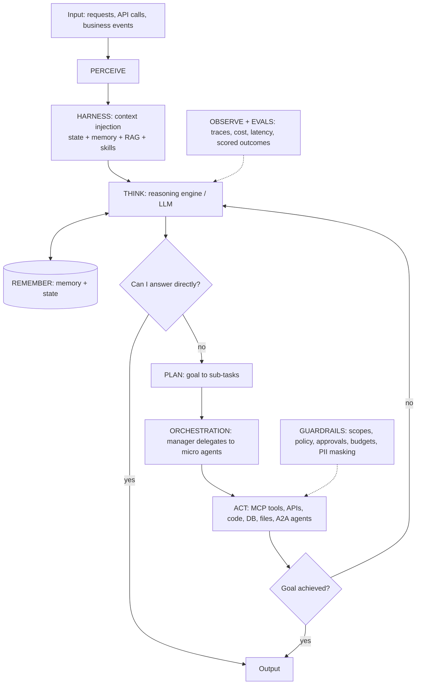

# Agentic Integration Portfolio

Enterprise AI agents for real business operations (orders, shipping, finance, customer service, IT operations and engineering) at **Ridgeline Supply Co.**, a fictional distributor. All eight projects share one framework, `agent-core`, which implements a seven-layer agent architecture and nine core agentic AI concepts. All data is synthetic.

## Architecture


## Projects
| # | Project | Business operation | Showcases |
|---|---------|--------------------|-----------|
| 01 | [Enterprise MCP Tool Gateway + Customer Service Copilot](projects/01-enterprise-mcp-gateway/README.md) | Customer service, IT platform | MCP, governance |
| 02 | [Order Management: Agentic EDI Order-to-Cash](projects/02-order-management-edi/README.md) | Orders, sales operations | RAG over partner guides, skills, human-in-the-loop |
| 03 | [Shipping & Logistics Exception Agents](projects/03-shipping-logistics-exceptions/README.md) | Shipping, logistics | State, actions with approvals |
| 04 | [Finance Operations: AP & AR Agents](projects/04-finance-operations/README.md) | Finance (AP, AR) | Orchestration, segregation of duties |
| 05 | [Integration Ops: Self-Healing Incident Commander](projects/05-integration-operations-self-healing/README.md) | IT operations | Orchestration, harness, chaos evals |
| 06 | [AI-Augmented Integration Delivery](projects/06-ai-augmented-integration-delivery/README.md) | Engineering | Harness (coding agents in CI) |
| 07 | [SAP Integration Suite: Order 360](projects/07-sap-order-360/README.md) | Customer service, credit | Governed ERP access |
| 08 | [Operations Command Center (A2A multi-agent)](projects/08-operations-command-center-a2a/README.md) | Cross-functional disputes | A2A, multi-agent system |

See [docs/AGENTIC_CONCEPTS.md](docs/AGENTIC_CONCEPTS.md) for the concept-by-project matrix.

## Repo layout
```
agent-core/          framework: 7 layers + 9 concepts, stdlib only, tested
projects/NN-*/       README, agents (one module per layer), skills/, knowledge/, evals/, a2a/
docs/                ARCHITECTURE, AGENTIC_CONCEPTS, COMPANY
scripts/             arch_check.py (architecture conformance)
```

## Quick start
```bash
make check       # tests + architecture check
make demo        # one agent run printing a span for every layer and concept
```

## Design principles
- **Agents propose; humans approve** anything that moves money, changes credit or pricing, or touches production.
- **Deterministic code does the math** (matching, rating, balancing). Agents explain and decide within policy.
- **Every tool is governed:** identity, scope, policy, approval, rate limit, audit.
- **Every agent is measured:** eval sets with a baseline that CI won't let regress.

---
Author: Brad Wartman · [LinkedIn](https://www.linkedin.com/in/brad-wartman)
