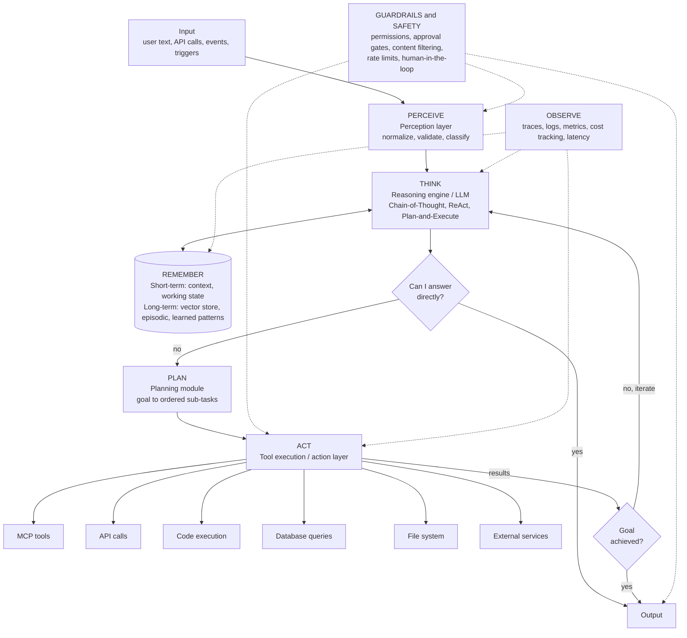

# Seven-layer agent architecture

Every project in this portfolio implements the same seven-layer agent anatomy: **Perceive → Think → Remember → Plan → Act → (Guardrails) → Observe**, with "goal achieved?" loops. Each project's `docs/agent-architecture.md` maps these layers to its concrete components, so any project can be walked through layer by layer.

## Free stack per layer (reused across projects)
| Layer | Default choice (free) | Notes |
|-------|----------------------|-------|
| Perceive | FastAPI ingest + Pydantic models | Every input becomes a typed, validated event before the LLM sees it |
| Think | A free local model (Ollama, or a llama.cpp server as in Project 01) behind a `provider` interface; a hosted model (e.g. Claude) is optional and never required | Use ReAct for tool-using loops, Plan-and-Execute for multi-step goals |
| Remember (short-term) | In-process session state, persisted to Postgres per run/session | Context window budget enforced; summarize when it grows |
| Remember (long-term) | Postgres + **pgvector** | Episodic memory (past runs/incidents), learned patterns, document embeddings |
| Plan | Explicit plan object (list of typed steps), logged before execution | Plans are inspectable and can be approved before they run |
| Act | MCP tools through the **Project 01 gateway**; direct APIs, SQL, files, code where appropriate | Tools have JSON schemas; outputs validated before re-entering the loop |
| Guardrails | Keycloak (identity), OPA (policy), n8n (approval gates), Pydantic output validation, rate limits, PII masking | Max-iteration cap and cost budget on every agent loop |
| Observe | OpenTelemetry + **Langfuse** (self-hosted, OSS) for LLM traces, tokens and cost; Prometheus/Grafana for system metrics | One trace ID from input to output across agent, gateway, and backends |

## Agent definition of done (applies to every project)
- [ ] All seven layers exist as identifiable modules and appear in `docs/agent-architecture.md` with a project-specific version of the diagram above
- [ ] "Can I answer directly?" short-circuit and "Goal achieved?" verification step are explicit code, not implied
- [ ] Loop has a max-iteration cap, timeout, and per-run cost budget; exceeding any one escalates to a human
- [ ] Long-term memory is written after each run and read before reasoning, with a measurable effect (show a before/after)
- [ ] Every LLM call, tool call, and memory read/write is traced with tokens, cost, and latency
- [ ] Guardrail denials are tested (unit tests prove the agent cannot exceed its permissions)
- [ ] A small eval set (10–30 cases) runs in CI and reports task success rate, tool-selection accuracy, and cost per task

## How agent-core implements it
| Layer | Module | Key types |
|-------|--------|-----------|
| Perceive | `agent-core/agentcore/perceive.py` | `Perceiver`, `Percept`, `Principal` |
| Think | `agent-core/agentcore/reason.py` | `LLMProvider` (`OllamaLLM`, `AnthropicLLM`, `FakeLLM`), `Reasoner`, `Decision` |
| Remember | `agent-core/agentcore/memory.py` | `ShortTermMemory`, `LongTermMemory`, `SQLiteMemory` (stand-in for pgvector) |
| Plan | `agent-core/agentcore/plan.py` | `Planner`, `LLMPlanner`, `Plan`, `Step` |
| Act | `agent-core/agentcore/act.py` | `Tool`, `ToolRegistry`, `Executor` |
| Guardrails | `agent-core/agentcore/guardrails.py` | `Guardrails`, `GuardrailViolation`, policy and approval hooks |
| Observe | `agent-core/agentcore/observe.py` | `Tracer`, `Span`, `InMemorySink`, `JSONLSink` |
| Loop | `agent-core/agentcore/loop.py` | `Agent`, `GoalVerifier`, `Outcome` |

The loop: perceive -> input guardrails -> recall memory -> think (answer directly? / one tool / plan / escalate) -> plan -> authorize + act per step -> results back to think -> goal check -> mask output -> write memory -> output. Budgets (iterations, tool calls, cost) are checked before every think step; exceeding one escalates.

## Agentic concepts on top of the layers
The loop is also the **harness**: before each THINK step it injects the current **state**, recalled **memory**, **RAG** citations and matching **skills**; it compacts long histories and writes a **progress file** every iteration. Managers **orchestrate** micro agents through `agent_as_tool`; remote agents are reached over **A2A**; system tools come through **MCP** (`register_tool_source`); every agent is scored by **evals**. See [AGENTIC_CONCEPTS.md](AGENTIC_CONCEPTS.md).
