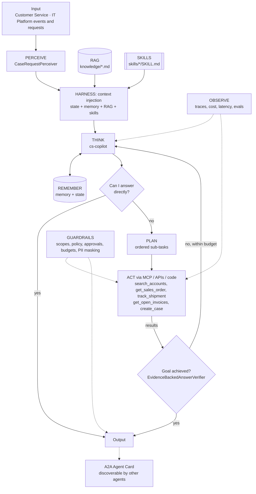

# Enterprise MCP Tool Gateway + Customer Service Copilot

> Part of the [Agentic Integration Portfolio](../../README.md): enterprise AI agents for a fictional company, Ridgeline Supply Co. All data is synthetic.

**Business operation:** Customer Service · IT Platform

A governed MCP gateway that gives every Ridgeline agent secure, scoped, audited access to ERP, CRM, carrier and AR systems, plus a Customer Service Copilot built on it.

## The business problem
Ridgeline's customer service reps answer "where is my order, my shipment and my invoice?" about 1,500 times a week by switching between the ERP, CRM, carrier portals and the AR system. Leadership wants an AI copilot. Security will only approve it if no agent can reach an enterprise system without identity, least-privilege policy, rate limits and an audit trail. This project builds that governed **MCP gateway**, which every other agent in the portfolio uses, and a **Customer Service Copilot** on top of it.

## Architecture


## Agentic AI concepts demonstrated
| # | Concept | How this project uses it |
|---|---------|--------------------------|
| 1 | Memory & State | Long-term: answered questions, account aliases (pgvector). State: the current case and its open orders, refreshed every iteration. |
| 2 | Orchestration | The gateway is the controlled **environment** that every manager and micro agent in Projects 02–08 acts through. |
| 3 | RAG | Customer service policy and escalation matrix are retrieved and cited (`[customer-service-policy.md#0]`). |
| 4 | Harness | agent-core loop: context injection (policy, skills, memory), compaction for long chats, progress files per conversation. |
| 5 | Evals | `evals/cases.json`: WISMO, billing dispute, policy questions, permission denials, out-of-scope refusals. |
| 6 | MCP | **Core of this project.** The gateway is an MCP server; the copilot connects through an MCP client (`McpToolSource` via `register_tool_source`). |
| 7 | Skills | `where-is-my-order`, `billed-not-delivered` runtime skills, loaded by trigger or `load_skill`. |
| 8 | A2A | The copilot publishes an Agent Card so the Command Center (Project 08) can delegate to it. |
| 9 | Multi-Agent System | One gateway serves many specialist agents, each with its own identity and scopes. |

## Run it
```bash
make test P=01          # from the repo root
make arch-check P=01
make eval P=01          # after Milestone 0
```

## Status
Eval results and a demo are added as milestones complete.
