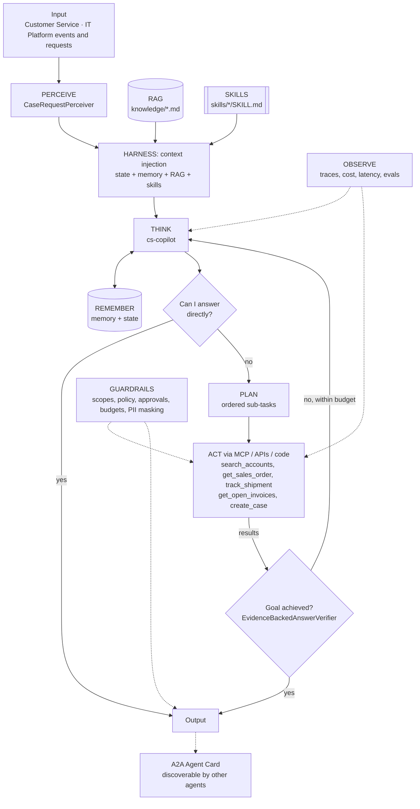

# Enterprise MCP Tool Gateway + Customer Service Copilot

> Part of the [Agentic Integration Portfolio](../../README.md): enterprise AI agents for a fictional company, Ridgeline Supply Co. All data is synthetic.

**Business operation:** Customer Service · IT Platform

A governed MCP gateway that gives every Ridgeline agent secure, scoped, audited access to ERP, CRM, carrier and AR systems, plus a Customer Service Copilot built on it.

## The business problem
Ridgeline's customer service reps answer "where is my order, my shipment and my invoice?" about 1,500 times a week by switching between the ERP, CRM, carrier portals and the AR system. Leadership wants an AI copilot. Security will only approve it if no agent can reach an enterprise system without identity, least-privilege policy, rate limits and an audit trail. This project builds that governed **MCP gateway**, which every other agent in the portfolio uses, and a **Customer Service Copilot** on top of it.

## Architecture


## Agentic AI concepts demonstrated
| # | Concept | How this project uses it |
|---|---------|--------------------------|
| 1 | Memory & State | Long-term: answered questions, account aliases (pgvector). State: the current case and its open orders, refreshed every iteration. |
| 2 | Orchestration | The gateway is the controlled **environment** that every manager and micro agent in Projects 02–08 acts through. |
| 3 | RAG | Customer service policy and escalation matrix are retrieved and cited (`[customer-service-policy.md#0]`). |
| 4 | Harness | agent-core loop: context injection (policy, skills, memory), compaction for long chats, progress files per conversation. |
| 5 | Evals | `evals/cases.json`: WISMO, billing dispute, policy questions, permission denials, out-of-scope refusals. |
| 6 | MCP | **Core of this project.** The gateway is an MCP server; the copilot connects through an MCP client (`McpToolSource` via `register_tool_source`). |
| 7 | Skills | `where-is-my-order`, `billed-not-delivered` runtime skills, loaded by trigger or `load_skill`. |
| 8 | A2A | The copilot publishes an Agent Card so the Command Center (Project 08) can delegate to it. |
| 9 | Multi-Agent System | One gateway serves many specialist agents, each with its own identity and scopes. |

## Run it
```bash
make up P=01            # from the repo root: build + start the MCP gateway (Docker Desktop)
make gateway-test P=01  # gateway contract tests, inside the container
make test P=01          # includes wire-level MCP tests while the gateway is up (skipped otherwise)
make arch-check P=01
make demo P=01          # offline demo with a scripted LLM; prints every span by layer
make eval P=01          # scripted evals vs evals/baseline.json
```

## Status
**Milestone 1 (MCP server skeleton): done.** The gateway is a real MCP server (official SDK `mcp==2.3.0`, streamable HTTP at `http://localhost:8765/mcp`) in Docker Compose, with one read-only tool, `get_sales_order`. It lists and runs from MCP Inspector (CLI and web UI) and is covered by in-container SDK tests and stdlib wire-level JSON-RPC tests. No authentication yet: it is published on loopback only until Keycloak arrives in Milestone 3. Details and Inspector commands: [gateway/README.md](gateway/README.md). Next: Milestone 2, connectors.

| Gateway (Milestone 1) | What works now |
|---|---|
| MCP | `initialize`, `tools/list`, `tools/call` over streamable HTTP; `get_sales_order` with a closed JSON Schema (`^SO-[0-9]{6}$`, `additionalProperties: false`), read-only annotations and structured output; unknown orders, malformed IDs, extra arguments and unknown tools all return `isError: true` |
| Act | Every call passes one choke point, `GatewayServer.call_tool`, where JWT (M3), OPA (M4) and audit (M5) will plug in. The gateway accepts only canonical IDs; the copilot normalises case and whitespace before calling |
| Guardrails | Loopback-only port, Host/Origin allowlist (foreign Host gets 421, foreign Origin 403), non-root read-only container with all capabilities dropped, not restarted automatically while unauthenticated; crash details stay server-side |
| Observe | Exactly one JSON log line per tool call for every outcome (`ok`, `not_found`, `invalid_arguments`, `unknown_tool`, `error`) with latency, JSON-RPC request id and `traceparent`/`X-Request-Id` when sent and well-formed (otherwise `"invalid"`). Argument values and unknown tool names are not logged; SDK INFO logs (session ids, caller text) are silenced |
| Supply chain | Base image pinned by digest; all 28 Python packages pinned with sha256 hashes (`gateway/requirements.lock`, regenerated by `gateway/lock-deps.sh`) |
| Tests | 16 in-container contract tests (`make gateway-test P=01`); 8 wire-level tests in `tests/test_gateway_http.py` (`REQUIRE_GATEWAY=1` makes a missing gateway a failure instead of a skip) |

**MCP Inspector CLI against the running gateway** (abridged from the JSON output of `npx -y @modelcontextprotocol/inspector@2.14.0 --cli http://localhost:8765/mcp --transport http ...`; gateway log lines verbatim; synthetic data):
```text
--method tools/list
  get_sales_order  "Sales order header, lines and delivery status from ERP (read-only; synthetic data)."
  inputSchema: {sales_order: string, pattern ^SO-[0-9]{6}$}, required [sales_order], additionalProperties false
  annotations: readOnlyHint true, destructiveHint false, idempotentHint true, openWorldHint false

--method tools/call --tool-name get_sales_order --tool-arg sales_order=SO-104233
  isError false | SO-104233 Summit Contractors LLC Shipped | delivery: SHP-55012 EXCEPTION

--method tools/call --tool-name get_sales_order --tool-arg sales_order=SO-999999
  isError true  | "Error executing tool get_sales_order: Sales order SO-999999 was not found in ERP."

gateway log
  {"event": "tool_call", "latency_ms": 1.61, "ok": true, "outcome": "ok", "request_id": "2", "tool": "get_sales_order"}
  {"event": "tool_call", "latency_ms": 1.07, "ok": false, "outcome": "not_found", "request_id": "2", "tool": "get_sales_order"}
```

**Milestone 0 (architecture skeleton): done.** The `cs-copilot` runs end to end on agent-core, offline, with a scripted LLM against seeded synthetic Ridgeline data. It still uses in-process mocks; it switches to the gateway through an MCP client in Milestone 6.

| Layer / concept | What works now |
|---|---|
| Perceive | `CaseRequestPerceiver`: free text or an inbound case → `Percept` with sales orders, POs, invoices, shipments and accounts (incl. aliases such as BBO) |
| State | Live case snapshot (account, open orders, shipment lateness, open invoice totals), re-read every iteration and **filtered by the caller's scopes** |
| Act | 5 tools over in-process mock CRM, ERP, carrier and AR systems (`mock_systems/`, deterministic by seed); the gateway replaces them in Milestone 6 |
| Guardrails | Scopes; a deny-by-default local policy (pricing, credit-limit and payment-term changes always denied; OPA in Milestone 4); writes fail closed until the n8n approval webhook (Milestone 5); budgets; PII masking of everything returned (answers and escalations). Progress files and traces keep raw tool output as internal, git-ignored audit records; masking at rest is decided with the audit log in Milestone 5 |
| Goal achieved? | Deterministic `EvidenceBackedAnswerVerifier` (below) |
| RAG, Skills, Plan, Memory, Harness, Observe | Cited policy chunks, trigger-matched skills, plan-and-execute, SQLite long-term memory (pgvector in Milestone 6), progress files, JSONL trace |

**Anti-hallucination guardrail: no invented IDs.** The verifier rejects an answer if any order, PO, invoice, shipment, account or case ID in it (`SO-`, `PO-`, `INV-`, `SHP-`, `ACCT-`, `CASE-` plus digits, any length) does not appear in the request or in a successful tool result. The same goes for money: every dollar amount must equal a number a tool returned, because deterministic code computes totals and the model only quotes them. Every entity in the request must be both addressed and looked up by a tool (a "not found" lookup counts; a policy citation never backs a claim about a customer's order). Every `[source.md#n]` citation must be a real knowledge chunk, and policy questions need a tool result or a valid citation. A rejected answer goes back to the reasoner with the reason, inside the iteration budget; the `invented-id-rejected-then-corrected` eval shows that loop. These checks catch fabricated identifiers and amounts; they do not prove every sentence true, which is what the real-model evals are for.

### Evals (scripted LLM, Milestone 0 baseline; unchanged in Milestone 1)
Scripted evals replay a fixed model script per case (`fixtures/llm/`), so they test the harness: tool selection, guardrails, verifier and citations, not model judgment. The real-model baseline (`evals/baseline.ollama.json`) arrives in Milestone 7.

Success 100% · tool selection 100% · avg cost $0.0026 (scripted) · avg iterations 2.5

| Case | Result | Tools used | What it shows |
|---|---|---|---|
| wismo-basic | PASS | get_sales_order, track_shipment | ReAct, one tool at a time, cited answer |
| billed-not-delivered | PASS | search_accounts, get_open_invoices, track_shipment | Plan-and-execute; billed 10 cartons vs 5 delivered |
| policy-direct | PASS | - | "Can I answer directly?" from a cited policy, no tools |
| readonly-cannot-create-case | PASS | search_accounts | Model tries `create_case`; the permission guardrail denies it |
| pricing-change-refused | PASS | - | The scripted model escalates; the policy hook's pricing denial is unit-tested |
| lead-create-case-needs-approval | PASS | search_accounts, get_sales_order | A lead holds `crm.write`, but the approval gate fails closed |
| unknown-order | PASS | - | The ERP "not found" error reaches the model, which says so instead of guessing |
| invented-id-rejected-then-corrected | PASS | get_sales_order, track_shipment | Verifier rejects an invented shipment ID; the model looks it up and corrects itself |

Oversized input (over 4,000 characters) is rejected by the input guardrail before any model call; that is covered by a unit test rather than an eval case.

### Demo (excerpt of `make demo P=01`)
```text
RUN 1  cs-rep asks: Summit Contractors says SO-104233 hasn't arrived and they were billed. What's going on?
status=answered  iterations=2  tool_calls=4  tools=['search_accounts', 'get_sales_order', 'track_shipment', 'get_open_invoices']  cost=$0.0030

ANSWER
SO-104233 for Summit Contractors LLC (ACCT-1002) shipped 2026-10-29 from Columbus OH with Granite Freight Lines
on SHP-55012. On 2026-11-05 delivery was attempted but the consignee's dock was closed. The new ETA is 2026-11-10,
3 business days past the promised 2026-11-05 (LTL freight is delivered within 5 business days of the ship date
[customer-service-policy.md#0]). Summit was billed $8,370.00 on INV-90388, which is still open. Because the
shipment is more than 2 business days late, notify Logistics and the account rep [escalation-matrix.md#0].
Next step: open a 'late delivery' case (needs a CS lead's approval) and confirm the new delivery window with
[EMAIL REDACTED].

TRACE (latency column omitted; "..." marks omitted lines)
  perceive   perceive.parse            {"kind": "cs_request"}
  guardrails guardrails.input          {}
  remember   remember.recall           {"hits": 0}
  remember   remember.retrieve         {"cites": ["customer-service-policy.md#0", "escalation-matrix.md#0"]}
  harness    harness.skills            {"active": ["billed-not-delivered", "where-is-my-order"]}
  remember   remember.state            {"keys": ["accounts", "as_of", "open_invoices", "open_orders", "orders", "shipments"]}
  think      think.decide              {"decision": "plan", "iteration": 1, "input_tokens": 100, "output_tokens": 20, ...
  plan       plan.make                 {"steps": ["Resolve the account", "Read the order and delivery status", ...
  guardrails guardrails.authorize      {"tool": "search_accounts"}
  act        act.search_accounts       {"ok": true}
  ...
  think      think.decide              {"decision": "answer", "iteration": 2, "input_tokens": 100, "output_tokens": 20, ...
  think      think.goal_check          {"achieved": true}
  guardrails guardrails.output         {}
  remember   remember.write            {}
  harness    harness.checkpoint        {"status": "answered"}

RUN 2  cs-rep asks: Open a case for Summit Contractors about the late delivery of SO-104233.
guardrail: Result of create_case: {"error": "denied by permission: cs-rep lacks scope crm.write for create_case", ...

RUN 3  cs-lead asks: Open a case for Summit Contractors about the late delivery of SO-104233.
guardrail: Result of create_case: {"error": "denied by approval_gate: write tool create_case not approved", ...

CRM cases created: 0 (writes fail closed until approvals exist)
```
