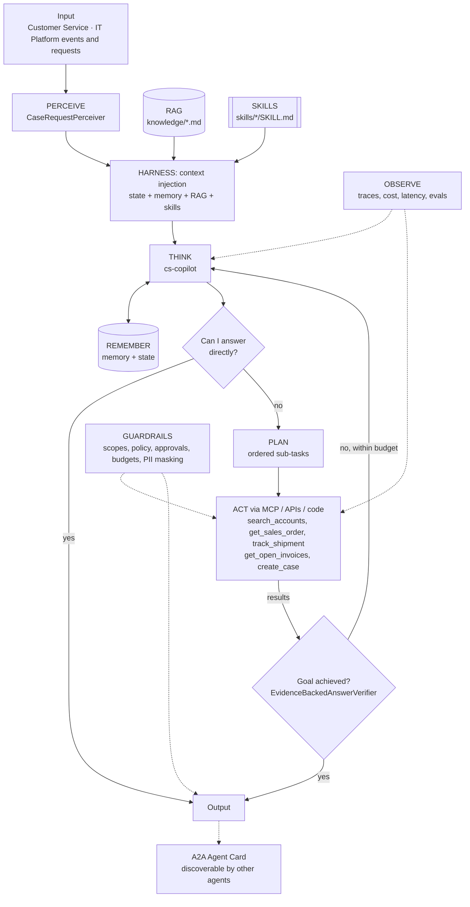
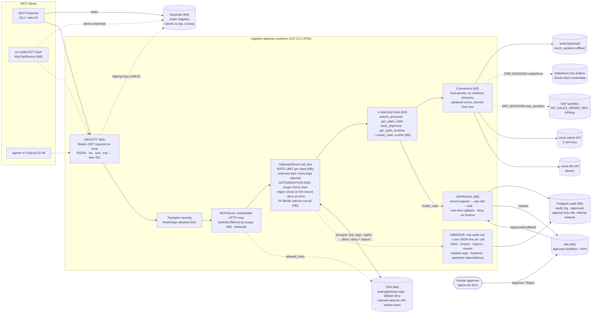

# Agent architecture: Enterprise MCP Tool Gateway + Customer Service Copilot

## Agents
| Agent | Role | Perceiver | Goal check | Planner | Delegates to |
|-------|------|-----------|-----------|---------|--------------|
| `cs-copilot` | specialist | `CaseRequestPerceiver` | `EvidenceBackedAnswerVerifier` | yes | - |

## Agentic AI concepts
| # | Concept | How this project uses it |
|---|---------|--------------------------|
| 1 | Memory & State | Long-term: answered questions, account aliases (pgvector). State: the current case and its open orders, refreshed every iteration. |
| 2 | Orchestration | The gateway is the controlled **environment** that every manager and micro agent in Projects 02–08 acts through. |
| 3 | RAG | Customer service policy and escalation matrix are retrieved and cited (`[customer-service-policy.md#0]`). |
| 4 | Harness | agent-core loop: context injection (policy, skills, memory), compaction for long chats, progress files per conversation. |
| 5 | Evals | `evals/cases.json`: WISMO, billing dispute, policy questions, permission denials, out-of-scope refusals. |
| 6 | MCP | **Core of this project.** The gateway is an MCP server; the copilot connects through an MCP client (`McpToolSource` via `register_tool_source`). |
| 7 | Skills | `where-is-my-order`, `billed-not-delivered` runtime skills, loaded by trigger or `load_skill`. |
| 8 | A2A | The copilot publishes an Agent Card so the Command Center (Project 08) can delegate to it. |
| 9 | Multi-Agent System | One gateway serves many specialist agents, each with its own identity and scopes. |

## The gateway (the environment every agent acts through)
The copilot's ACT layer will reach enterprise systems only through this MCP server. Build-out by milestone: **M1** server skeleton (done), **M2** connectors (done; live check passed against Salesforce and the SAP sandbox), **M3** Keycloak identity (done), **M4** OPA authorization (done), **M5** rate limits + PII masking + audit + approvals (done), M6 the copilot switches to `McpToolSource`.

| Gateway concern | Now (Milestone 5) | Code |
|---|---|---|
| MCP (concept 6) | Server side: `initialize`, `tools/list`, `tools/call` over streamable HTTP; four read-only tools with the copilot's names, arguments and shapes | `gateway/ridgeline_gateway/server.py` |
| Act | Tools call connectors, the only code that talks to backends. Each system has a `seed` backend and a live one (Salesforce, SAP sandbox, mock carrier/AR APIs), chosen in `.env`. Deterministic code computes AR totals. The gateway enforces canonical IDs; the copilot normalises case/whitespace | `connectors/`, `mock_apis/` |
| Guardrails | Closed JSON Schemas; secrets only from env, masked, least privilege per container; fail-closed startup; read-only (GET) connectors pinned to host and port, with no redirects, size caps and timeouts; mock APIs on an internal-only network; Salesforce `instance_url` validated before the token is sent; sanitized upstream errors; loopback-only port; DNS-rebinding protection; hardened containers; digest- and hash-pinned images | `config.py`, `connectors/base.py`, `docker-compose.yml`, Dockerfiles, lock files |
| Observe | One JSON line per call for every outcome, with verified `client_id`/`scopes`/`regions`, backend, upstream status and latency, request id and trace headers; a denial is outcome `denied` with the policy's reason code (`policy_reason`) and `policy_ms`; `auth_rejected` lines give the reason; no argument values, secrets or tokens | `server.py` `_log_call`, `auth.py`, `connectors/base.py` |
| Identity (Guardrails, M3) | Keycloak realm `ridgeline`: one confidential client per agent (`cs-rep`, `cs-lead`), service-account grant only, scopes matching the copilot's tools. The gateway verifies RS256 JWTs (exact issuer, audience `ridgeline-gateway`, expiry) and fails closed with 401 + an RFC 9728 challenge. Each client's token also carries a signed `regions` claim (`cs-rep`: Central; `cs-lead`: every region) | `auth.py`, `keycloak/ridgeline-realm.json`, `docker-compose.yml` |
| Authorization (Guardrails, M4) | Open Policy Agent decides, the gateway enforces, default deny. **Scope rule:** each tool needs its scope. **Restricted changes:** pricing, credit-limit and payment-term changes are always denied. **Data rule:** a record is returned only if its account's region is one of the caller's regions; an unknown region is lead-only. The call is checked before the tool runs and again on the resolved record before anything is returned; a tool that skips the data check is refused. `tools/list` shows only the tools a caller's scopes cover. OPA unreachable, slow or malformed means deny, and the gateway will not start without it. Region denials say "access denied" (existence is disclosed to internal reps on purpose) | `policy.py`, `server.py`, `policy/gateway.rego`, `policy/data.json`, `policy/system_authz.rego` |
| Approvals (Guardrails, M5) | Agents propose, a human approves. `create_case`, the only write, runs after the policy checks and an explicit Approve from a named person in the n8n form. The request is recorded before anyone is asked; rejection, timeout (`APPROVAL_TIMEOUT_S`), n8n failure or a lost record all refuse the write. Approval links reach only the operator, never an agent. n8n is on a network only the gateway shares and checks a shared secret on its webhook | `approvals.py`, `server.py`, `../n8n/ridgeline-approval.json` |
| Audit (Observe, M5) | One Postgres row per authenticated tool call, allowed, denied or cancelled, with the reason code and masked arguments; approvals in their own table. Append-only database role; a read that cannot be audited is not returned. `GET /audit` with scope `audit.read` (operator identity `p01-auditor` only) | `audit.py`, `../audit/init.sh`, `admin/audit_report.py` |
| PII and rate limits (Guardrails, M5) | Contact emails and phones masked in results without `crm.pii`; a sliding one-minute limit per client before policy or any backend. Reason codes for every denial come from one list in `policy/data.json` | `pii.py`, `ratelimit.py`, `policy.py` |
| Multi-Agent (concept 9) | Each agent has its own identity, scopes and regions; the policy decides per agent, and the gateway logs which agent made each call and why it was denied | same |
| Memory & State (concept 1, partial) | Account aliases (`BBO` for Big Box Outdoor) are searchable in the CRM (SOSL in Salesforce); long-term memory itself is M6 | `connectors/salesforce.py` |
| Tests | Config, connector (fake transports) and tool-contract tests in the gateway image; mock-API tests over real HTTP; stdlib wire-level tests over the running stack; `make live-check` for the live sandboxes. Policy: Rego unit tests (`make opa-test`), gateway tests against a real OPA, and one decision table (`policy/decision_cases.json`) run against both the Rego and the copilot's offline copy | `gateway/tests/`, `mock_apis/tests/`, `tests/test_gateway_http.py`, `tests/test_policy.py`, `policy/gateway_test.rego`, `admin/live_check.py` |

## Guardrails on the copilot side (Milestone 5)
| Layer / concept | What changed | Code |
|---|---|---|
| Guardrails | Restricted argument names are matched at any depth, in the Rego and in the offline copy alike. The approval hook refuses every write unless an approver is installed; none is by default, and only an explicit `True` approves. The copilot reaches the gateway's n8n approval in Milestone 6 | `cs_copilot/agent/guardrails.py`, `policy/gateway.rego` |
| Harness, Observe | Progress files and traces are masked at rest with the same PII mask as answers, through the opt-in `redact` hook on agent-core's `Checkpointer` and `JSONLSink` (tests first) | `agent-core/agentcore/harness.py`, `observe.py`, `cs_copilot/agent/build.py`, `observe.py` |
| Evals | `lead-create-case-approved`, `-rejected`, `-approval-timeout`: each script names the human decision it assumes | `evals/cases.json`, `fixtures/llm/` |

## The policy on the copilot side (Milestone 4)
The copilot's GUARDRAILS layer applies the same policy as the gateway, so a denial reaches THINK as data and the agent escalates instead of working around it.

| Layer / concept | What changed | Code |
|---|---|---|
| Guardrails | `policy_hook` builds `{principal, tool, args}` and, once it knows which record the call would read, the record's region. With `OPA_URL` set it asks OPA and denies on any error. Without it (offline demo, tests, scripted evals) it uses `local_decision`, a copy of the Rego that reads the same `policy/data.json` and is tested against the same decision table | `cs_copilot/agent/guardrails.py` |
| State | The injected snapshot is filtered by the region rule as well as by scope: a record outside the caller's region appears only as "access denied", never with its contents | `cs_copilot/agent/state.py` |
| Memory | Recall obeys the access policy: each remembered answer is tagged with the caller's audience (scopes + regions) and recalled only for the same audience; untagged items are never recalled. Milestone 6 moves this filter into the pgvector query | `cs_copilot/agent/build.py` (`memory_audience`), `agent-core/agentcore/loop.py` |
| agent-core | `Principal.attributes` carries verified, non-scope claims (here `regions`) to policy hooks and state providers; `EvalCase.attributes` sets them per eval case | `agent-core/agentcore/types.py`, `evals.py` |
| RAG | `knowledge/data-access-policy.md`: regions, what to do when access is denied | `knowledge/` |
| Skills | `where-is-my-order` and `billed-not-delivered` say to stop and escalate to a CS lead on a region denial | `skills/` |
| Evals | `out-of-region-order-denied` (denied twice, escalates, nothing leaks) and `lead-cross-region-allowed` | `evals/cases.json`, `fixtures/llm/` |

Until the copilot calls the gateway (Milestone 6) it resolves a record's region from the in-process mock systems, and a search that would return any account outside the caller's regions is denied whole. After that the gateway does the data check and filters search results itself.
