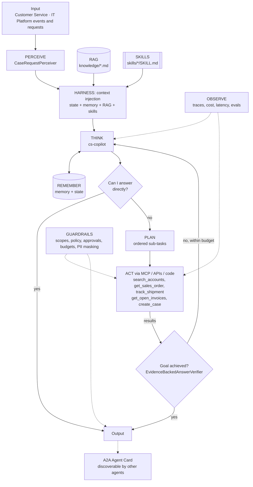
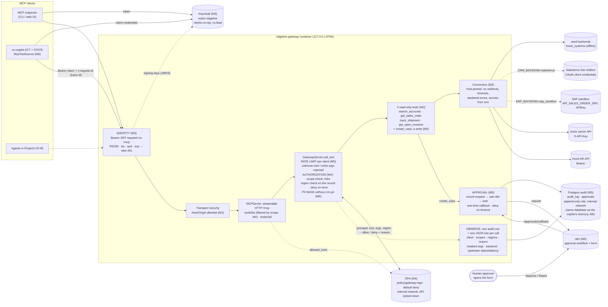
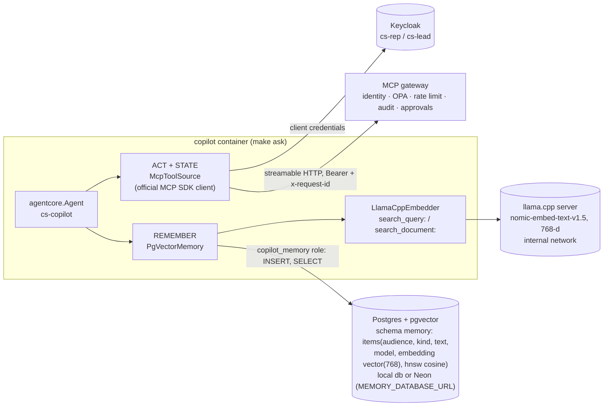

# Agent architecture: Enterprise MCP Tool Gateway + Customer Service Copilot

## Agents
| Agent | Role | Perceiver | Goal check | Planner | Delegates to |
|-------|------|-----------|-----------|---------|--------------|
| `cs-copilot` | specialist | `CaseRequestPerceiver` | `EvidenceBackedAnswerVerifier` | yes | - |

## Agentic AI concepts
| # | Concept | How this project uses it |
|---|---------|--------------------------|
| 1 | Memory & State | Long-term: answered questions, account aliases (pgvector). State: the current case and its open orders, refreshed every iteration. |
| 2 | Orchestration | The gateway is the controlled **environment** that every manager and micro agent in Projects 02–08 acts through. |
| 3 | RAG | Customer service policy and escalation matrix are retrieved and cited (`[customer-service-policy.md#0]`). |
| 4 | Harness | agent-core loop: context injection (policy, skills, memory), compaction for long chats, progress files per conversation. |
| 5 | Evals | `evals/cases.json`: WISMO, billing dispute, policy questions, permission denials, out-of-scope refusals. |
| 6 | MCP | **Core of this project.** The gateway is an MCP server; the copilot connects through an MCP client (`McpToolSource` via `register_tool_source`). |
| 7 | Skills | `where-is-my-order`, `billed-not-delivered` runtime skills, loaded by trigger or `load_skill`. |
| 8 | A2A | The copilot publishes an Agent Card so the Command Center (Project 08) can delegate to it. |
| 9 | Multi-Agent System | One gateway serves many specialist agents, each with its own identity and scopes. |

## The gateway (the environment every agent acts through)
The copilot's ACT layer reaches enterprise systems only through this MCP server. Build-out by milestone: **M1** server skeleton, **M2** connectors (live check passed against Salesforce and the SAP sandbox), **M3** Keycloak identity, **M4** OPA authorization, **M5** rate limits + PII masking + audit + approvals, **M6** the copilot calls it through `McpToolSource` (all done).

| Gateway concern | Now (Milestone 5) | Code |
|---|---|---|
| MCP (concept 6) | Server side: `initialize`, `tools/list`, `tools/call` over streamable HTTP; four read-only tools with the copilot's names, arguments and shapes | `gateway/ridgeline_gateway/server.py` |
| Act | Tools call connectors, the only code that talks to backends. Each system has a `seed` backend and a live one (Salesforce, SAP sandbox, mock carrier/AR APIs), chosen in `.env`. Deterministic code computes AR totals. The gateway enforces canonical IDs; the copilot normalises case/whitespace | `connectors/`, `mock_apis/` |
| Guardrails | Closed JSON Schemas; secrets only from env, masked, least privilege per container; fail-closed startup; read-only (GET) connectors pinned to host and port, with no redirects, size caps and timeouts; mock APIs on an internal-only network; Salesforce `instance_url` validated before the token is sent; sanitized upstream errors; loopback-only port; DNS-rebinding protection; hardened containers; digest- and hash-pinned images | `config.py`, `connectors/base.py`, `docker-compose.yml`, Dockerfiles, lock files |
| Observe | One JSON line per call for every outcome, with verified `client_id`/`scopes`/`regions`, backend, upstream status and latency, request id and trace headers; a denial is outcome `denied` with the policy's reason code (`policy_reason`) and `policy_ms`; `auth_rejected` lines give the reason; no argument values, secrets or tokens | `server.py` `_log_call`, `auth.py`, `connectors/base.py` |
| Identity (Guardrails, M3) | Keycloak realm `ridgeline`: one confidential client per agent (`cs-rep`, `cs-lead`), service-account grant only, scopes matching the copilot's tools. The gateway verifies RS256 JWTs (exact issuer, audience `ridgeline-gateway`, expiry) and fails closed with 401 + an RFC 9728 challenge. Each client's token also carries a signed `regions` claim (`cs-rep`: Central; `cs-lead`: every region) | `auth.py`, `keycloak/ridgeline-realm.json`, `docker-compose.yml` |
| Authorization (Guardrails, M4) | Open Policy Agent decides, the gateway enforces, default deny. **Scope rule:** each tool needs its scope. **Restricted changes:** pricing, credit-limit and payment-term changes are always denied. **Data rule:** a record is returned only if its account's region is one of the caller's regions; an unknown region is lead-only. The call is checked before the tool runs and again on the resolved record before anything is returned; a tool that skips the data check is refused. `tools/list` shows only the tools a caller's scopes cover. OPA unreachable, slow or malformed means deny, and the gateway will not start without it. Region denials say "access denied" (existence is disclosed to internal reps on purpose) | `policy.py`, `server.py`, `policy/gateway.rego`, `policy/data.json`, `policy/system_authz.rego` |
| Approvals (Guardrails, M5) | Agents propose, a human approves. `create_case`, the only write, runs after the policy checks and an explicit Approve from a named person in the n8n form. The request is recorded before anyone is asked; rejection, timeout (`APPROVAL_TIMEOUT_S`), n8n failure or a lost record all refuse the write. Approval links reach only the operator, never an agent. n8n is on a network only the gateway shares and checks a shared secret on its webhook | `approvals.py`, `server.py`, `../n8n/ridgeline-approval.json` |
| Audit (Observe, M5) | One Postgres row per authenticated tool call, allowed, denied or cancelled, with the reason code and masked arguments; approvals in their own table. Append-only database role; a read that cannot be audited is not returned. `GET /audit` with scope `audit.read` (operator identity `p01-auditor` only). Since M6 each row carries the copilot's trace id (`make audit P=01 ARGS=--trace=<id>`) | `audit.py`, `../db/audit.sql`, `../db/init.sh`, `admin/audit_report.py` |
| PII and rate limits (Guardrails, M5) | Contact emails and phones masked in results without `crm.pii`; a sliding one-minute limit per client before policy or any backend. Reason codes for every denial come from one list in `policy/data.json` | `pii.py`, `ratelimit.py`, `policy.py` |
| Multi-Agent (concept 9) | Each agent has its own identity, scopes and regions; the policy decides per agent, and the gateway logs which agent made each call and why it was denied | same |
| Memory & State (concept 1) | Account aliases (`BBO` for Big Box Outdoor) are searchable in the CRM (SOSL in Salesforce). The copilot's long-term memory (M6, below) lives in the same Postgres, in its own schema and role | `connectors/salesforce.py`, `../db/memory.sql` |
| Tests | Config, connector (fake transports) and tool-contract tests in the gateway image; mock-API tests over real HTTP; stdlib wire-level tests over the running stack; `make live-check` for the live sandboxes. Policy: Rego unit tests (`make opa-test`), gateway tests against a real OPA, and one decision table (`policy/decision_cases.json`) run against both the Rego and the copilot's offline copy | `gateway/tests/`, `mock_apis/tests/`, `tests/test_gateway_http.py`, `tests/test_policy.py`, `policy/gateway_test.rego`, `admin/live_check.py` |

## Real models, evals and A2A (Milestone 7)
| Layer / concept | What changed | Code |
|---|---|---|
| Think | Real providers beside the scripted one, still only in `reason.py`. **Local** (the official real-model baseline, free): Qwen2.5-1.5B-Instruct on llama.cpp's OpenAI-compatible server, JSON mode so every reply is one valid object, cost $0. **Optional, paid:** Claude through the official `anthropic` SDK (pinned in the copilot image) for anyone who plugs in a hosted model: model, prices and effort from `.env`, adaptive thinking, server-side refusal fallbacks with the answering model recorded, a refusal turned into an escalation, cost from token usage. No project baseline uses it. Harness fixes found by tracing the local model: the reasoner infers a missing decision type when it is unambiguous; the verifier's feedback names the exact citation form | `cs_copilot/agent/reason.py`, `cs_copilot/agent/verify.py`, `agent-core/agentcore/reason.py` |
| Evals | One case list for every model. A case's human decision for writes (`approval`) moved from the scripted fixtures into `cases.json`, so a real model is judged on the same scenario. Expected answer fragments may list alternative phrasings, so cases test facts, not wording. Reports add latency and total cost. Real models run in the copilot container on the offline backend (no gateway, database or Neon) with their own per-case cost cap and baseline, compared with a tolerance of one case. Three new cases: an alias lookup, an unknown account, a two-document policy answer | `evals/`, `agent-core/agentcore/evals.py` |
| A2A | The copilot's Agent Card (`a2a/cs-copilot.card.json`, skills with examples, an `oauth2` client-credentials security scheme) and `message/send` on 127.0.0.1:8701. Keycloak token passthrough: the server verifies the caller's token like the gateway does, builds the principal from its verified scopes and regions, and runs the copilot with that token, so the gateway authorizes and audits each call as the real caller. agent-core's `serve_agent` gained per-request authentication | `cs_copilot/a2a_server.py`, `agent-core/agentcore/a2a.py` |
| Multi-Agent | Registered in Project 08's `a2a/registry.json` (`"auth": "keycloak-client-credentials"`), with a routing eval case there | `../08-operations-command-center-a2a/` |
| Guardrails (tests) | Every database is stamped `main`, `test` or `local`; the gateway reports the stamp in `/healthz`, and the wire tests refuse to run unless it is `test` or `local`. `make up DB=test` uses a Neon `test` branch with its own roles; demo runs keep `main` | `db/stamp.sql`, `gateway/ridgeline_gateway/server.py`, `tests/test_gateway_http.py` |

## The copilot on the gateway (Milestone 6)
`make ask P=01 Q="..."` runs the copilot in its own container. Its tools and its state snapshot are the gateway's MCP tools, called with the asking role's Keycloak token, so every read the agent makes, including the context injected into its prompt, is authorized by OPA, rate-limited and audited under the run's trace id. Long-term memory is Postgres + pgvector.

| Layer / concept | What changed | Code |
|---|---|---|
| MCP (concept 6) | `McpToolSource` implements agent-core's `ToolSource` with the official SDK over streamable HTTP. `build.py` registers the gateway's tools with `register_tool_source`, taking each tool's scope and side effect from the copilot's own `policy/data.json`, never from the server's description. The gateway lists only what the caller's token may use, so a rep's registry has no `create_case`. A gateway refusal comes back as a tool error that THINK sees as data | `cs_copilot/agent/mcp_client.py`, `build.py` |
| State | `GatewayStateProvider` builds the snapshot through the same tools, once per record per iteration. A refused record shows as "access denied" without contents (closes the Milestone 0 TODO) | `cs_copilot/agent/state.py` |
| Guardrails | With the gateway backend the copilot still checks scope and restricted changes before a call, and leaves the region rule to the gateway, which knows each record's account. `create_case` passes to the gateway's human approval (n8n) and waits; any other write is refused locally | `cs_copilot/agent/guardrails.py` |
| Memory | `PgVectorMemory`: masked text, the caller's audience and the embedding model stored with each vector; recall filters on both in SQL and orders by cosine distance. An episode's vector is its question, so new questions are compared with past questions. A database or embedder failure skips memory and never loses the answer | `cs_copilot/agent/memory.py`, `db/memory.sql` |
| Memory (aliases) | An `on_answer` hook (new in agent-core) keeps a search that found exactly one account under another name ("bbo") as an alias memory for that audience; recall brings it into later prompts | `build.py` `learn_aliases`, `agent-core/agentcore/loop.py` |
| Embeddings | llama.cpp's OpenAI-compatible server with nomic-embed-text-v1.5 (Q8_0, 768 dimensions; `make models` downloads it, SHA-256 pinned). Offline runs use a deterministic hashing embedder; vectors of different models are never compared | `cs_copilot/agent/embeddings.py`, `copilot/fetch_model.py` |
| Observe | agent-core exposes the current trace id (`current_trace_id()`); the copilot sends it as `x-request-id`, so the gateway's audit rows for a run join to its trace | `agent-core/agentcore/observe.py`, `admin/audit_report.py --trace` |
| Think | Until Milestone 7 picks a local chat model, `make ask` replays scripted plans for known questions. A script step can branch on a tool's real result, so a case request's answer follows the human's actual decision | `cs_copilot/agent/reason.py`, `fixtures/llm/ask-lead-create-case.json` |
| Least privilege | Roles: `gateway_audit` (audit tables only) and `copilot_memory` (INSERT/SELECT on `memory.items` only), locally and in Neon (`make db-roles`). Verified live: each role is refused the other's tables and any UPDATE, DELETE, TRUNCATE, DDL | `db/init.sh`, `db/roles.py`, `db/memory.sql` |

## Guardrails on the copilot side (Milestone 5)
| Layer / concept | What changed | Code |
|---|---|---|
| Guardrails | Restricted argument names are matched at any depth, in the Rego and in the offline copy alike. The approval hook refuses every write unless an approver is installed; none is by default, and only an explicit `True` approves. Since Milestone 6, on the gateway, `create_case` goes to the gateway's n8n approval instead | `cs_copilot/agent/guardrails.py`, `policy/gateway.rego` |
| Harness, Observe | Progress files and traces are masked at rest with the same PII mask as answers, through the opt-in `redact` hook on agent-core's `Checkpointer` and `JSONLSink` (tests first) | `agent-core/agentcore/harness.py`, `observe.py`, `cs_copilot/agent/build.py`, `observe.py` |
| Evals | `lead-create-case-approved`, `-rejected`, `-approval-timeout`: each script names the human decision it assumes | `evals/cases.json`, `fixtures/llm/` |

## The policy on the copilot side (Milestone 4)
The copilot's GUARDRAILS layer applies the same policy as the gateway, so a denial reaches THINK as data and the agent escalates instead of working around it.

| Layer / concept | What changed | Code |
|---|---|---|
| Guardrails | `policy_hook` builds `{principal, tool, args}` and, once it knows which record the call would read, the record's region. With `OPA_URL` set it asks OPA and denies on any error. Without it (offline demo, tests, scripted evals) it uses `local_decision`, a copy of the Rego that reads the same `policy/data.json` and is tested against the same decision table | `cs_copilot/agent/guardrails.py` |
| State | The injected snapshot is filtered by the region rule as well as by scope: a record outside the caller's region appears only as "access denied", never with its contents | `cs_copilot/agent/state.py` |
| Memory | Recall obeys the access policy: each remembered answer is tagged with the caller's audience (scopes + regions) and recalled only for the same audience; untagged items are never recalled. Milestone 6 moves this filter into the pgvector query | `cs_copilot/agent/build.py` (`memory_audience`), `agent-core/agentcore/loop.py` |
| agent-core | `Principal.attributes` carries verified, non-scope claims (here `regions`) to policy hooks and state providers; `EvalCase.attributes` sets them per eval case | `agent-core/agentcore/types.py`, `evals.py` |
| RAG | `knowledge/data-access-policy.md`: regions, what to do when access is denied | `knowledge/` |
| Skills | `where-is-my-order` and `billed-not-delivered` say to stop and escalate to a CS lead on a region denial | `skills/` |
| Evals | `out-of-region-order-denied` (denied twice, escalates, nothing leaks) and `lead-cross-region-allowed` | `evals/cases.json`, `fixtures/llm/` |

Offline (demo, tests, scripted evals) the copilot still resolves a record's region from the in-process mock systems, and a search that would return any account outside the caller's regions is denied whole. On the gateway (Milestone 6) the gateway does the data check per record and filters search results itself.
