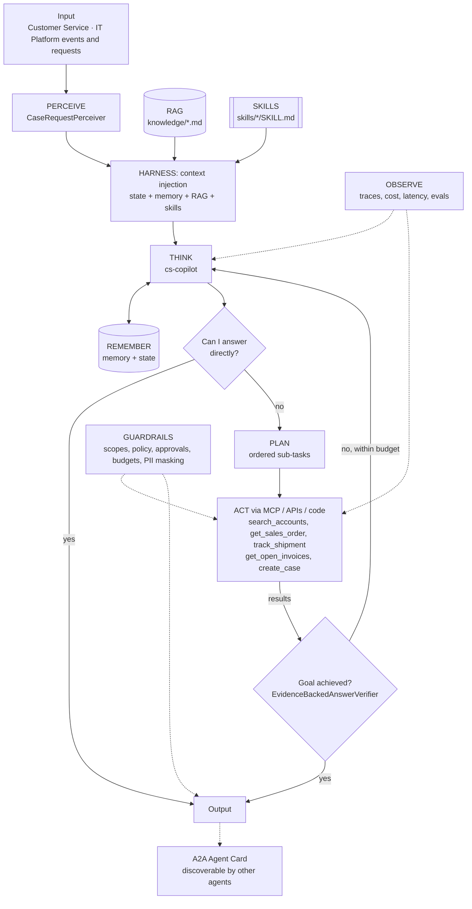
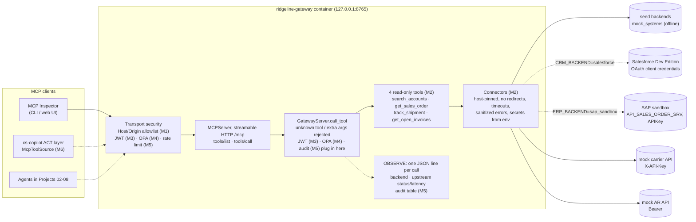

# Agent architecture: Enterprise MCP Tool Gateway + Customer Service Copilot

## Agents
| Agent | Role | Perceiver | Goal check | Planner | Delegates to |
|-------|------|-----------|-----------|---------|--------------|
| `cs-copilot` | specialist | `CaseRequestPerceiver` | `EvidenceBackedAnswerVerifier` | yes | - |

## Agentic AI concepts
| # | Concept | How this project uses it |
|---|---------|--------------------------|
| 1 | Memory & State | Long-term: answered questions, account aliases (pgvector). State: the current case and its open orders, refreshed every iteration. |
| 2 | Orchestration | The gateway is the controlled **environment** that every manager and micro agent in Projects 02–08 acts through. |
| 3 | RAG | Customer service policy and escalation matrix are retrieved and cited (`[customer-service-policy.md#0]`). |
| 4 | Harness | agent-core loop: context injection (policy, skills, memory), compaction for long chats, progress files per conversation. |
| 5 | Evals | `evals/cases.json`: WISMO, billing dispute, policy questions, permission denials, out-of-scope refusals. |
| 6 | MCP | **Core of this project.** The gateway is an MCP server; the copilot connects through an MCP client (`McpToolSource` via `register_tool_source`). |
| 7 | Skills | `where-is-my-order`, `billed-not-delivered` runtime skills, loaded by trigger or `load_skill`. |
| 8 | A2A | The copilot publishes an Agent Card so the Command Center (Project 08) can delegate to it. |
| 9 | Multi-Agent System | One gateway serves many specialist agents, each with its own identity and scopes. |

## The gateway (the environment every agent acts through)
The copilot's ACT layer will reach enterprise systems only through this MCP server. Build-out by milestone: **M1** server skeleton (done), **M2** connectors (offline done; live Salesforce/SAP check pending credentials), M3 Keycloak JWT, M4 OPA, M5 rate limits + PII masking + audit + approvals, M6 the copilot switches to `McpToolSource`.

| Gateway concern | Now (Milestone 2) | Code |
|---|---|---|
| MCP (concept 6) | Server side: `initialize`, `tools/list`, `tools/call` over streamable HTTP; four read-only tools with the copilot's names, arguments and shapes | `gateway/ridgeline_gateway/server.py` |
| Act | Tools call connectors, the only code that talks to backends. Each system has a `seed` backend and a live one (Salesforce, SAP sandbox, mock carrier/AR APIs), chosen in `.env`. Deterministic code computes AR totals. The gateway enforces canonical IDs; the copilot normalises case/whitespace | `connectors/`, `mock_apis/` |
| Guardrails | Closed JSON Schemas; secrets only from env, masked, least privilege per container; fail-closed startup; read-only (GET) connectors pinned to host and port, with no redirects, size caps and timeouts; mock APIs on an internal-only network; Salesforce `instance_url` validated before the token is sent; sanitized upstream errors; loopback-only port; DNS-rebinding protection; hardened containers; digest- and hash-pinned images. **No identity yet (M3)** | `config.py`, `connectors/base.py`, `docker-compose.yml`, Dockerfiles, lock files |
| Observe | One JSON line per call for every outcome, with backend, upstream status and latency, request id and trace headers; no argument values or secrets | `server.py` `_log_call`, `connectors/base.py` |
| Memory & State (concept 1, partial) | Account aliases (`BBO` for Big Box Outdoor) are searchable in the CRM (SOSL in Salesforce); long-term memory itself is M6 | `connectors/salesforce.py` |
| Tests | Config, connector (fake transports) and tool-contract tests in the gateway image; mock-API tests over real HTTP; stdlib wire-level tests over the running stack; `make live-check` for the live sandboxes | `gateway/tests/`, `mock_apis/tests/`, `tests/test_gateway_http.py`, `admin/live_check.py` |
