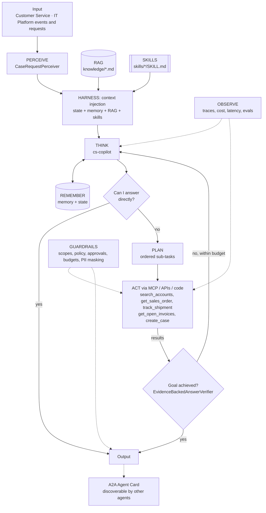
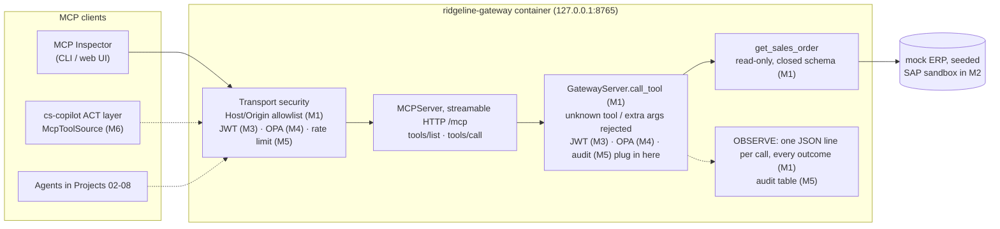

# Agent architecture: Enterprise MCP Tool Gateway + Customer Service Copilot

## Agents
| Agent | Role | Perceiver | Goal check | Planner | Delegates to |
|-------|------|-----------|-----------|---------|--------------|
| `cs-copilot` | specialist | `CaseRequestPerceiver` | `EvidenceBackedAnswerVerifier` | yes | - |

## Agentic AI concepts
| # | Concept | How this project uses it |
|---|---------|--------------------------|
| 1 | Memory & State | Long-term: answered questions, account aliases (pgvector). State: the current case and its open orders, refreshed every iteration. |
| 2 | Orchestration | The gateway is the controlled **environment** that every manager and micro agent in Projects 02–08 acts through. |
| 3 | RAG | Customer service policy and escalation matrix are retrieved and cited (`[customer-service-policy.md#0]`). |
| 4 | Harness | agent-core loop: context injection (policy, skills, memory), compaction for long chats, progress files per conversation. |
| 5 | Evals | `evals/cases.json`: WISMO, billing dispute, policy questions, permission denials, out-of-scope refusals. |
| 6 | MCP | **Core of this project.** The gateway is an MCP server; the copilot connects through an MCP client (`McpToolSource` via `register_tool_source`). |
| 7 | Skills | `where-is-my-order`, `billed-not-delivered` runtime skills, loaded by trigger or `load_skill`. |
| 8 | A2A | The copilot publishes an Agent Card so the Command Center (Project 08) can delegate to it. |
| 9 | Multi-Agent System | One gateway serves many specialist agents, each with its own identity and scopes. |

## The gateway (the environment every agent acts through)
The copilot's ACT layer will reach enterprise systems only through this MCP server. Build-out by milestone: **M1** server skeleton (done), M2 connectors, M3 Keycloak JWT, M4 OPA, M5 rate limits + PII masking + audit + approvals, M6 the copilot switches to `McpToolSource`.

| Gateway concern | Milestone 1 | Code |
|---|---|---|
| MCP (concept 6) | Server side: `initialize`, `tools/list`, `tools/call` over streamable HTTP | `gateway/ridgeline_gateway/server.py` |
| Act | One tool, `get_sales_order`: same name and parameter as the copilot's tool. The gateway enforces `^SO-[0-9]{6}$`; the copilot normalises case/whitespace before calling. Every call passes `GatewayServer.call_tool` | same |
| Guardrails | Closed JSON Schema (`additionalProperties: false`, extra arguments rejected); loopback-only port; DNS-rebinding protection; hardened container; digest- and hash-pinned image. **No identity yet (M3)** | `server.py`, `docker-compose.yml`, `gateway/Dockerfile`, `gateway/requirements.lock` |
| Observe | One JSON line per call for every outcome, with request id and trace headers when present; no argument values | `server.py` `_log_call` |
| Tests | SDK contract tests in the container; stdlib wire-level JSON-RPC tests against the running container | `gateway/tests/`, `tests/test_gateway_http.py` |
