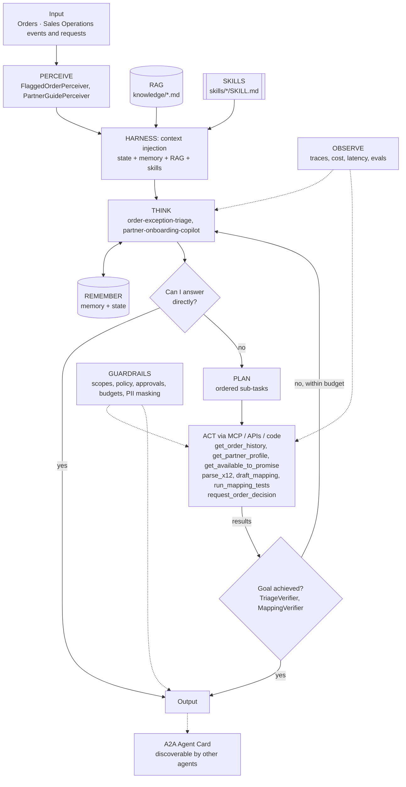

# Order Management: Agentic EDI Order-to-Cash

> Part of the [Agentic Integration Portfolio](../../README.md): enterprise AI agents for a fictional company, Ridgeline Supply Co. All data is synthetic.

**Business operation:** Orders · Sales Operations

An X12 order pipeline (850 -> 855 -> 856 -> 810) where agents triage order exceptions and onboard new retail partners, while deterministic code owns the money path.

## The business problem
Big Box Outdoor and 40 other retailers send Ridgeline about 3,000 X12 850 purchase orders a week. Most flow straight through. The rest (quantity spikes, unknown SKUs, price mismatches, new ship-to locations, items short in stock) land in a shared inbox and age for days, and retailers charge back for late order acknowledgements. Onboarding a new retail partner's EDI mapping takes six weeks. This project automates the clean path and adds an **Order Exception Triage Agent** and a **Partner Onboarding Copilot**.

## Architecture


## Agentic AI concepts demonstrated
| # | Concept | How this project uses it |
|---|---------|--------------------------|
| 1 | Memory & State | Memory: partner order history and resolved exceptions. State: live ATP and the order's current status each iteration. |
| 2 | Orchestration | A deterministic pipeline is the orchestrator: clean orders flow straight through; only exceptions are routed to the triage agent and new partners to the copilot. |
| 3 | RAG | Partner implementation guides and retail compliance rules, retrieved with citations. |
| 4 | Harness | agent-core loop with progress files per order, so an aged exception shows exactly where triage stopped. |
| 5 | Evals | Planted exceptions (price, quantity, ship-to) and onboarding cases with expected tools. |
| 6 | MCP | Order tools are also published through the Project 01 gateway for other agents. |
| 7 | Skills | `price-mismatch-resolution`, `quantity-spike-triage`, `x12-850-mapping`. |
| 8 | A2A | The triage agent publishes an Agent Card ('order-exceptions') used by Project 08. |
| 9 | Multi-Agent System | Two specialists (triage, onboarding) with separate prompts, tools and scopes. |

## Run it
```bash
make test P=02          # from the repo root
make arch-check P=02
make eval P=02          # after Milestone 0
```

## Status
**Scaffold.** The agents assemble on agent-core with every layer and concept wired, and the architecture checks pass; the layer implementations are next. Eval results and a demo are added as milestones complete.

### Roadmap
| # | Milestone | Scope | Status |
|---|---|---|---|
| 0 | Architecture skeleton | Perceiver, state provider, tools on local mocks and goal verifiers, so every agent runs end to end on agent-core with a scripted LLM. | Planned |
| 1 | Parse and acknowledge | Ingest 850s, parse to canonical JSON, generate 997s; synthetic 850 generator. | Planned |
| 2 | Outbound documents | Generate 855/856/810 from the canonical model and mock ERP state. | Planned |
| 3 | Rules + anomaly detection | Deterministic rules plus statistical detector over 6 months of synthetic history; ATP mock. | Planned |
| 4 | Triage agent + n8n approval | Triage agent with skills and RAG; n8n approval workflow; decision flows back via webhook. | Planned |
| 5 | Partner onboarding copilot | Plan-and-execute mapping drafting with RAG over the implementation guide. | Planned |
| 6 | Evals, metrics, A2A card | Eval report + baseline; Grafana metrics; publish the triage Agent Card. | Planned |

### Evals
`evals/cases.json` holds 4 cases so far; `make eval P=02` runs them once the agents are implemented (Milestone 0), and the first run becomes the baseline that later runs must not fall below.

| Case | Input | Expected status | Must call | Must not call | Result |
|---|---|---|---|---|---|
| price-mismatch | PO-7710 from BBO flagged: line 2 price 18.40 vs agreement 19.95 for SKU RG-HELM-02. | answered | get_partner_profile, request_order_decision | - | not run yet |
| qty-spike-short-stock | PO-7722 from BBO flagged: 1,200 cases of RG-GLOVE-L vs typical 120. | answered | get_order_history, get_available_to_promise | - | not run yet |
| new-ship-to | PO-7731 flagged: unknown ship-to 0457 for Pinecrest Hardware. | answered | get_partner_profile | - | not run yet |
| onboard-partner | Onboard Trailhead Sports for X12 850 using their guide and 5 sample files. | answered | parse_x12, draft_mapping, run_mapping_tests | - | not run yet |
