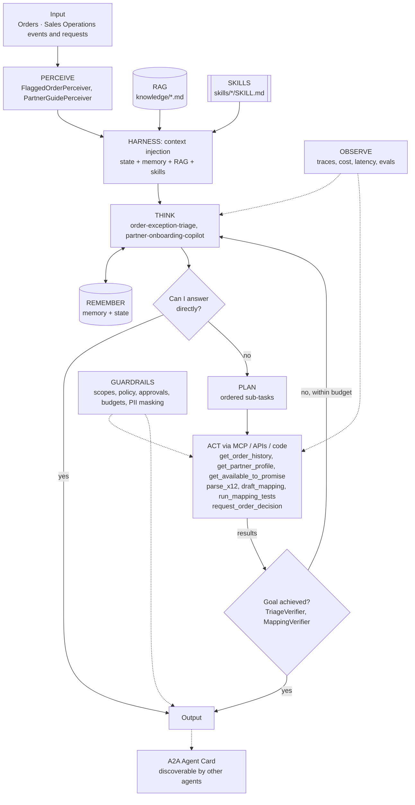

# Order Management: Agentic EDI Order-to-Cash

> Part of the [Agentic Integration Portfolio](../../README.md): enterprise AI agents for a fictional company, Ridgeline Supply Co. All data is synthetic.

**Business operation:** Orders · Sales Operations

An X12 order pipeline (850 -> 855 -> 856 -> 810) where agents triage order exceptions and onboard new retail partners, while deterministic code owns the money path.

## The business problem
Big Box Outdoor and 40 other retailers send Ridgeline about 3,000 X12 850 purchase orders a week. Most flow straight through. The rest (quantity spikes, unknown SKUs, price mismatches, new ship-to locations, items short in stock) land in a shared inbox and age for days, and retailers charge back for late order acknowledgements. Onboarding a new retail partner's EDI mapping takes six weeks. This project automates the clean path and adds an **Order Exception Triage Agent** and a **Partner Onboarding Copilot**.

## Architecture


## Agentic AI concepts demonstrated
| # | Concept | How this project uses it |
|---|---------|--------------------------|
| 1 | Memory & State | Memory: partner order history and resolved exceptions. State: live ATP and the order's current status each iteration. |
| 2 | Orchestration | A deterministic pipeline is the orchestrator: clean orders flow straight through; only exceptions are routed to the triage agent and new partners to the copilot. |
| 3 | RAG | Partner implementation guides and retail compliance rules, retrieved with citations. |
| 4 | Harness | agent-core loop with progress files per order, so an aged exception shows exactly where triage stopped. |
| 5 | Evals | Planted exceptions (price, quantity, ship-to) and onboarding cases with expected tools. |
| 6 | MCP | Order tools are also published through the Project 01 gateway for other agents. |
| 7 | Skills | `price-mismatch-resolution`, `quantity-spike-triage`, `x12-850-mapping`. |
| 8 | A2A | The triage agent publishes an Agent Card ('order-exceptions') used by Project 08. |
| 9 | Multi-Agent System | Two specialists (triage, onboarding) with separate prompts, tools and scopes. |

## Run it
```bash
make test P=02          # from the repo root
make arch-check P=02
make eval P=02          # after Milestone 0
```

## Status
Eval results and a demo are added as milestones complete.
