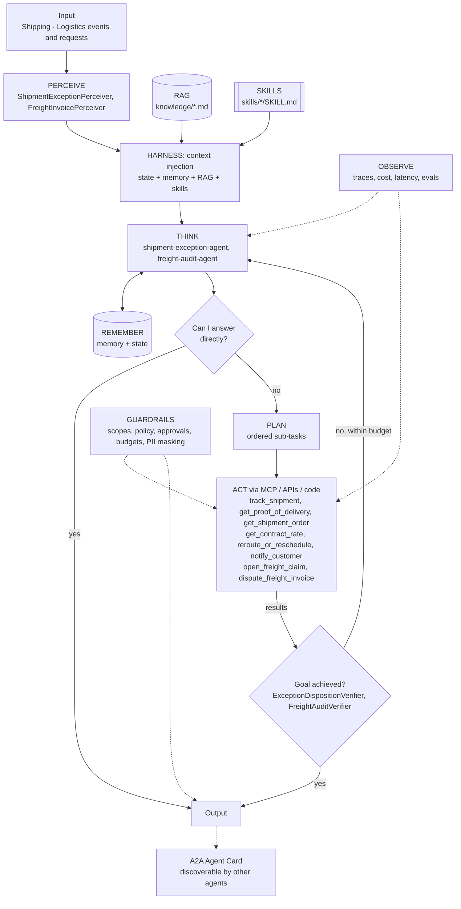

# Agent architecture: Shipping & Logistics: Shipment Exception and Freight Audit Agents

## Agents
| Agent | Role | Perceiver | Goal check | Planner | Delegates to |
|-------|------|-----------|-----------|---------|--------------|
| `shipment-exception-agent` | specialist | `ShipmentExceptionPerceiver` | `ExceptionDispositionVerifier` | yes | - |
| `freight-audit-agent` | specialist | `FreightInvoicePerceiver` | `FreightAuditVerifier` | no | - |

## Agentic AI concepts
| # | Concept | How this project uses it |
|---|---------|--------------------------|
| 1 | Memory & State | **Showcase of State:** the live shipment snapshot is re-read every iteration, so the agent sees its own reroute take effect. Memory: carrier/lane performance and past claims. |
| 2 | Orchestration | Exception events are routed by type to the right specialist (exception agent vs freight audit agent). |
| 3 | RAG | Carrier contracts and customer delivery requirements, cited in every decision. |
| 4 | Harness | Progress files per shipment; compaction for long multi-day exceptions. |
| 5 | Evals | Late, short, damaged, no-action-needed and freight-billing cases, including 'should NOT act' cases. |
| 6 | MCP | Carrier and TMS mocks are exposed as MCP tools through the Project 01 gateway. |
| 7 | Skills | `late-delivery-playbook`, `damaged-or-short-delivery`, `freight-invoice-audit`. |
| 8 | A2A | The exception agent publishes an Agent Card ('shipment-status') used by Project 08. |
| 9 | Multi-Agent System | Exception and freight-audit specialists share evidence (late beyond SLA -> refund eligibility). |
