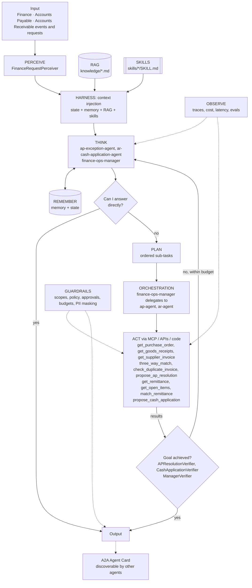

# Finance Operations: AP Exception and AR Cash Application Agents

> Part of the [Agentic Integration Portfolio](../../README.md): enterprise AI agents for a fictional company, Ridgeline Supply Co. All data is synthetic.

**Business operation:** Finance · Accounts Payable · Accounts Receivable

A Finance Ops manager agent that orchestrates AP (3-way match exceptions) and AR (cash application, short pays, deductions) specialists, with SOX-style segregation of duties: agents propose, humans post.

## The business problem
Ridgeline's AP team processes 12,000 supplier invoices a month, and 18% fail 3-way match (PO vs goods receipt vs invoice) and wait in an exception queue. AR applies about $30M a month in remittances. Short payments and retailer deductions (shortage, pricing, compliance fines) pile up unresolved, so DSO creeps up and month-end close slips. This project adds an **AP Exception Agent**, an **AR Cash Application Agent**, and a **Finance Ops Manager** that orchestrates them.

## Architecture


## Agentic AI concepts demonstrated
| # | Concept | How this project uses it |
|---|---------|--------------------------|
| 1 | Memory & State | Memory: vendor and customer patterns. State: period status (no proposals into a closed period) and live queue totals. |
| 2 | Orchestration | **Showcase of Orchestration:** the Finance Ops Manager breaks the queue into sub-tasks and delegates to AP and AR micro agents (`agent_as_tool`), each with least-privilege scopes. |
| 3 | RAG | AP tolerance and AR deduction policies, cited in every proposal. |
| 4 | Harness | Deterministic matching engines are tools (action); agents add judgment and explanation; progress files make every proposal auditable. |
| 5 | Evals | Tolerance, quantity, duplicate, short-pay and manager-delegation cases; cash must balance to the cent. |
| 6 | MCP | Finance tools are published through the Project 01 gateway with ap.*/ar.* scopes. |
| 7 | Skills | `three-way-match-variance`, `short-pay-resolution`. |
| 8 | A2A | The AR agent publishes an Agent Card ('ar-deductions') used by Project 08. |
| 9 | Multi-Agent System | Manager + two specialists; segregation of duties enforced by separate identities. |

## Run it
```bash
make test P=04          # from the repo root
make arch-check P=04
make eval P=04          # after Milestone 0
```

## Status
**Scaffold.** The agents assemble on agent-core with every layer and concept wired, and the architecture checks pass; the layer implementations are next. Eval results and a demo are added as milestones complete.

### Roadmap
| # | Milestone | Scope | Status |
|---|---|---|---|
| 0 | Architecture skeleton | Perceiver, state provider, tools on local mocks and goal verifiers, so every agent runs end to end on agent-core with a scripted LLM. | Planned |
| 1 | Synthetic finance data + mock API | Generator for POs, receipts, supplier invoices (planted variances, duplicates) and remittances (short pays, deduction codes). | Planned |
| 2 | AP exception agent | Deterministic three_way_match + duplicate check tools; AP agent with RAG and skills. | Planned |
| 3 | AR cash application agent | Deterministic remittance matcher; AR agent with deduction coding. | Planned |
| 4 | Finance Ops Manager orchestration | Manager agent delegating to AP/AR via agent_as_tool; combined summary. | Planned |
| 5 | Segregation of duties + evals | Tests proving agents cannot post or pay; eval set + baseline. | Planned |
| 6 | A2A card + dashboard | Publish the AR Agent Card; Grafana finance ops dashboard. | Planned |
