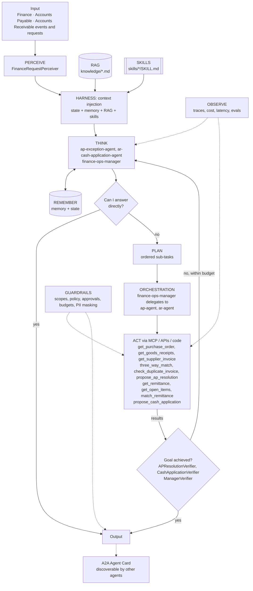

# Agent architecture: Finance Operations: AP Exception and AR Cash Application Agents

## Agents
| Agent | Role | Perceiver | Goal check | Planner | Delegates to |
|-------|------|-----------|-----------|---------|--------------|
| `ap-exception-agent` | specialist | `FinanceRequestPerceiver` | `APResolutionVerifier` | no | - |
| `ar-cash-application-agent` | specialist | `FinanceRequestPerceiver` | `CashApplicationVerifier` | no | - |
| `finance-ops-manager` | manager (orchestrator) | `FinanceRequestPerceiver` | `ManagerVerifier` | yes | ap-agent, ar-agent |

## Agentic AI concepts
| # | Concept | How this project uses it |
|---|---------|--------------------------|
| 1 | Memory & State | Memory: vendor and customer patterns. State: period status (no proposals into a closed period) and live queue totals. |
| 2 | Orchestration | **Showcase of Orchestration:** the Finance Ops Manager breaks the queue into sub-tasks and delegates to AP and AR micro agents (`agent_as_tool`), each with least-privilege scopes. |
| 3 | RAG | AP tolerance and AR deduction policies, cited in every proposal. |
| 4 | Harness | Deterministic matching engines are tools (action); agents add judgment and explanation; progress files make every proposal auditable. |
| 5 | Evals | Tolerance, quantity, duplicate, short-pay and manager-delegation cases; cash must balance to the cent. |
| 6 | MCP | Finance tools are published through the Project 01 gateway with ap.*/ar.* scopes. |
| 7 | Skills | `three-way-match-variance`, `short-pay-resolution`. |
| 8 | A2A | The AR agent publishes an Agent Card ('ar-deductions') used by Project 08. |
| 9 | Multi-Agent System | Manager + two specialists; segregation of duties enforced by separate identities. |
