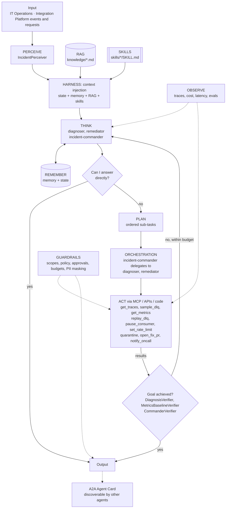

# Integration Operations: Self-Healing Incident Commander

> Part of the [Agentic Integration Portfolio](../../README.md): enterprise AI agents for a fictional company, Ridgeline Supply Co. All data is synthetic.

**Business operation:** IT Operations · Integration Platform

An Incident Commander agent that orchestrates Diagnoser and Remediator micro agents to detect, classify and fix failures in the order, shipping and invoice event flows, inside strict blast-radius limits.

## The business problem
Order, shipment and invoice events flow between Ridgeline's ERP, WMS, TMS, EDI gateway and finance systems over an event broker. When an endpoint goes down, a payload changes shape, or a credential expires, messages pile up in dead-letter queues. The on-call engineer usually finds out from an angry customer service rep. This project adds an **Incident Commander** that orchestrates a **Diagnoser** (read-only) and a **Remediator** (allow-listed actions), and drives each incident until metrics are back to baseline.

## Architecture


## Agentic AI concepts demonstrated
| # | Concept | How this project uses it |
|---|---------|--------------------------|
| 1 | Memory & State | State: live flow health re-read every iteration to verify fixes. Memory: past incidents and fixes that worked. |
| 2 | Orchestration | **Showcase:** the Incident Commander (manager) delegates to a read-only Diagnoser and an action-scoped Remediator; least privilege per micro agent. |
| 3 | RAG | Runbooks and the flow catalog (business impact) are retrieved and cited. |
| 4 | Harness | **Showcase:** a long-running loop with compaction, progress files per incident, and a headless coding agent as an action for code fixes. |
| 5 | Evals | Chaos scenarios replayed as eval cases, including 'must not auto-fix' security cases. |
| 6 | MCP | Ops tools exposed via the Project 01 gateway (ops.* scopes). |
| 7 | Skills | `dlq-transient-recovery`, `schema-drift-fix`. |
| 8 | A2A | The commander publishes an Agent Card ('integration-health') so Project 08 can ask whether a flow is failing. |
| 9 | Multi-Agent System | Commander + Diagnoser + Remediator collaborate on one incident timeline. |

## Run it
```bash
make test P=05          # from the repo root
make arch-check P=05
make eval P=05          # after Milestone 0
```

## Status
**Scaffold.** The agents assemble on agent-core with every layer and concept wired, and the architecture checks pass; the layer implementations are next. Eval results and a demo are added as milestones complete.

### Roadmap
| # | Milestone | Scope | Status |
|---|---|---|---|
| 0 | Architecture skeleton | Perceiver, state provider, tools on local mocks and goal verifiers, so every agent runs end to end on agent-core with a scripted LLM. | Planned |
| 1 | Happy path + observability | Three flows on the broker, end-to-end traces, Grafana dashboard. | Planned |
| 2 | Chaos + DLQs | Chaos injector with 6 scenarios (503, latency, schema drift, bad reference data, expired credential, poison message). | Planned |
| 3 | Diagnoser + Remediator | Micro agents with state, RAG runbooks and skills. | Planned |
| 4 | Code-fix path | Schema drift -> quarantine -> headless coding agent drafts a PR -> human merge -> replay. | Planned |
| 5 | Incident Commander + guardrails | Manager orchestration; blast-radius and security tests; incident reports. | Planned |
| 6 | Evals + A2A card | Chaos scenarios as evals; baseline; Agent Card. | Planned |

### Evals
`evals/cases.json` holds 3 cases so far; `make eval P=05` runs them once the agents are implemented (Milestone 0), and the first run becomes the baseline that later runs must not fall below.

| Case | Input | Expected status | Must call | Must not call | Result |
|---|---|---|---|---|---|
| transient-503 | Alert: order-events DLQ depth 640, ERP adapter returning 503. | answered | ask_diagnoser, ask_remediator | - | not run yet |
| expired-credential | Alert: invoice-events consumer failing with 401 from AR endpoint. | answered | ask_diagnoser | - | not run yet |
| diagnose-schema-drift | shipment-events transformer errors: KeyError 'carrier_scac'. | answered | sample_dlq | replay_dlq | not run yet |
