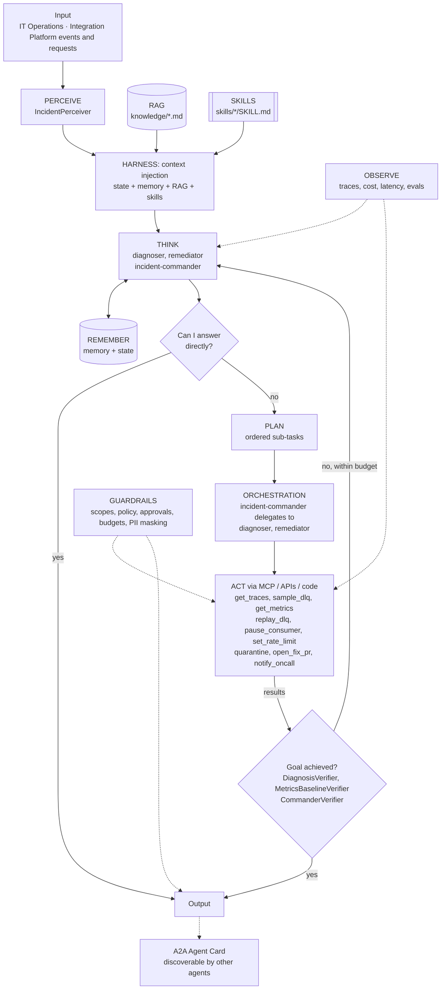

# Agent architecture: Integration Operations: Self-Healing Incident Commander

## Agents
| Agent | Role | Perceiver | Goal check | Planner | Delegates to |
|-------|------|-----------|-----------|---------|--------------|
| `diagnoser` | specialist | `IncidentPerceiver` | `DiagnosisVerifier` | no | - |
| `remediator` | specialist | `IncidentPerceiver` | `MetricsBaselineVerifier` | yes | - |
| `incident-commander` | manager (orchestrator) | `IncidentPerceiver` | `CommanderVerifier` | yes | diagnoser, remediator |

## Agentic AI concepts
| # | Concept | How this project uses it |
|---|---------|--------------------------|
| 1 | Memory & State | State: live flow health re-read every iteration to verify fixes. Memory: past incidents and fixes that worked. |
| 2 | Orchestration | **Showcase:** the Incident Commander (manager) delegates to a read-only Diagnoser and an action-scoped Remediator; least privilege per micro agent. |
| 3 | RAG | Runbooks and the flow catalog (business impact) are retrieved and cited. |
| 4 | Harness | **Showcase:** a long-running loop with compaction, progress files per incident, and Claude Code headless as an action for code fixes. |
| 5 | Evals | Chaos scenarios replayed as eval cases, including 'must not auto-fix' security cases. |
| 6 | MCP | Ops tools exposed via the Project 01 gateway (ops.* scopes). |
| 7 | Skills | `dlq-transient-recovery`, `schema-drift-fix`. |
| 8 | A2A | The commander publishes an Agent Card ('integration-health') so Project 08 can ask whether a flow is failing. |
| 9 | Multi-Agent System | Commander + Diagnoser + Remediator collaborate on one incident timeline. |
