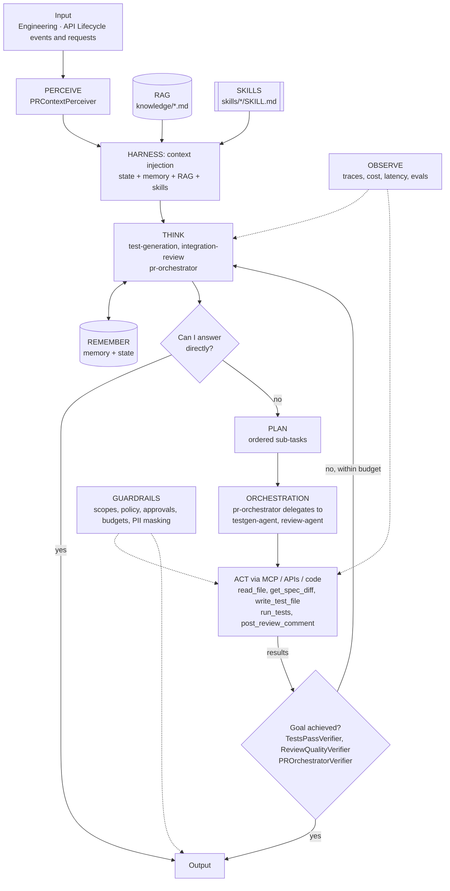

# Integration Delivery: AI-Augmented CI/CD with Test and Review Agents

> Part of the [Agentic Integration Portfolio](../../README.md): enterprise AI agents for a fictional company, Ridgeline Supply Co. All data is synthetic.

**Business operation:** Engineering · API Lifecycle

A PR Orchestrator that runs a Test Generation agent and an Integration Review agent inside Jenkins, with API governance enforced as code and humans owning every merge.

## The business problem
Ridgeline's integration team ships changes to the order, shipping and finance APIs from Projects 02–04 every week. Reviews are inconsistent: missing auth, unbounded list endpoints, no timeouts and breaking changes slip through, and test coverage of new endpoints lags. This project adds a governed delivery pipeline where a **PR Orchestrator** coordinates a **Test Generation Agent** and an **Integration Review Agent**.

## Architecture


## Agentic AI concepts demonstrated
| # | Concept | How this project uses it |
|---|---------|--------------------------|
| 1 | Memory & State | State: CI stage results for this PR. Memory: which AI tests and review findings humans accepted (learned patterns). |
| 2 | Orchestration | The PR Orchestrator delegates to the test-generation and review micro agents; the Jenkins pipeline is the environment. |
| 3 | RAG | API standards retrieved and cited in review comments. |
| 4 | Harness | **Showcase:** A headless coding agent is the THINK provider inside CI, with persistence via git commits (separate `ai-generated` commit) and progress files. |
| 5 | Evals | PR scenarios with expected tools, including 'do nothing' docs-only PRs. |
| 6 | MCP | Optional: GitHub and Jenkins tools behind the Project 01 gateway. |
| 7 | Skills | `integration-review-checklist`, `api-test-generation`. |
| 8 | A2A | Not exposed externally (internal engineering agent); documented as a deliberate choice. |
| 9 | Multi-Agent System | Orchestrator + two specialists with different write scopes (tests vs comments). |

## Run it
```bash
make test P=06          # from the repo root
make arch-check P=06
make eval P=06          # after Milestone 0
```

## Status
**Scaffold.** The agents assemble on agent-core with every layer and concept wired, and the architecture checks pass; the layer implementations are next. Eval results and a demo are added as milestones complete.

### Roadmap
| # | Milestone | Scope | Status |
|---|---|---|---|
| 0 | Architecture skeleton | Perceiver, state provider, tools on local mocks and goal verifiers, so every agent runs end to end on agent-core with a scripted LLM. | Planned |
| 1 | Jenkins + Spectral | Local Jenkins runs the Spectral governance ruleset on every push. | Planned |
| 2 | Tests + JFrog | Unit/property tests for the services; image pushed to JFrog free tier. | Planned |
| 3 | Test generation agent | Headless coding agent provider; test-gen micro agent. | Planned |
| 4 | Review agent + breaking-change gate | Review micro agent with checklist skill; oasdiff gate. | Planned |
| 5 | PR Orchestrator + evals | Manager orchestration; eval set; metrics dashboard. | Planned |

### Evals
`evals/cases.json` holds 3 cases so far; `make eval P=06` runs them once the agents are implemented (Milestone 0), and the first run becomes the baseline that later runs must not fall below.

| Case | Input | Expected status | Must call | Must not call | Result |
|---|---|---|---|---|---|
| new-endpoint-tests | PR 42 adds GET /v1/shipments/{id}/pod to the shipping API. | answered | get_spec_diff, write_test_file, run_tests | - | not run yet |
| missing-timeout-review | PR 43 adds an outbound call to the carrier API without a timeout. | answered | read_file, post_review_comment | - | not run yet |
| docs-only-skip | PR 44 only changes README.md. | answered | - | write_test_file, post_review_comment | not run yet |
