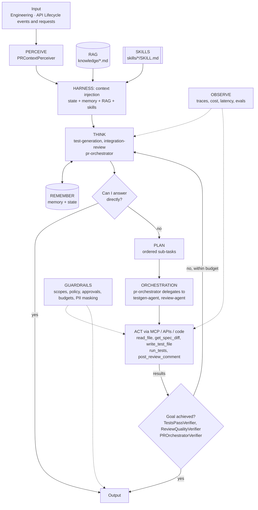

# Agent architecture: Integration Delivery: AI-Augmented CI/CD with Test and Review Agents

## Agents
| Agent | Role | Perceiver | Goal check | Planner | Delegates to |
|-------|------|-----------|-----------|---------|--------------|
| `test-generation` | specialist | `PRContextPerceiver` | `TestsPassVerifier` | yes | - |
| `integration-review` | specialist | `PRContextPerceiver` | `ReviewQualityVerifier` | no | - |
| `pr-orchestrator` | manager (orchestrator) | `PRContextPerceiver` | `PROrchestratorVerifier` | yes | testgen-agent, review-agent |

## Agentic AI concepts
| # | Concept | How this project uses it |
|---|---------|--------------------------|
| 1 | Memory & State | State: CI stage results for this PR. Memory: which AI tests and review findings humans accepted (learned patterns). |
| 2 | Orchestration | The PR Orchestrator delegates to the test-generation and review micro agents; the Jenkins pipeline is the environment. |
| 3 | RAG | API standards retrieved and cited in review comments. |
| 4 | Harness | **Showcase:** A headless coding agent is the THINK provider inside CI, with persistence via git commits (separate `ai-generated` commit) and progress files. |
| 5 | Evals | PR scenarios with expected tools, including 'do nothing' docs-only PRs. |
| 6 | MCP | Optional: GitHub and Jenkins tools behind the Project 01 gateway. |
| 7 | Skills | `integration-review-checklist`, `api-test-generation`. |
| 8 | A2A | Not exposed externally (internal engineering agent); documented as a deliberate choice. |
| 9 | Multi-Agent System | Orchestrator + two specialists with different write scopes (tests vs comments). |
