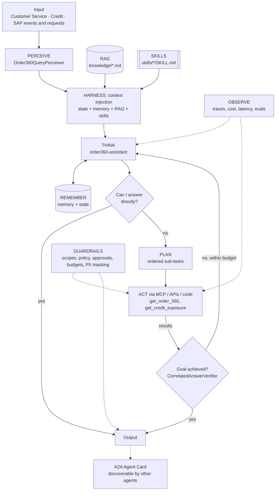

# SAP Integration Suite: Order 360 Assistant (orders, deliveries, billing, credit)

> Part of the [Agentic Integration Portfolio](../../README.md): enterprise AI agents for a fictional company, Ridgeline Supply Co. All data is synthetic.

**Business operation:** Customer Service · Credit · SAP

An assistant that answers order, delivery, billing and credit-hold questions from SAP S/4HANA through three governance layers: MCP gateway -> SAP API Management -> SAP Cloud Integration (CPI).

## The business problem
When a contractor's order is stuck, the answer is spread across SAP sales orders, deliveries, billing documents and credit management, plus the CRM. Reps don't know SAP transaction codes, and IT won't give an AI agent direct ERP access. This project builds a **CPI iFlow** that assembles an Order 360 view, publishes it through **SAP API Management**, and lets an **Order 360 Assistant** reach it only through the Project 01 MCP gateway.

## Architecture


## Agentic AI concepts demonstrated
| # | Concept | How this project uses it |
|---|---------|--------------------------|
| 1 | Memory & State | Memory: customer aliases. State: the customer's open orders and credit status during the conversation. |
| 2 | Orchestration | CPI multicast orchestrates S/4 + CRM calls; the agent sees one governed tool. |
| 3 | RAG | SAP status glossary retrieved so codes become plain English. |
| 4 | Harness | Correlation id flows from agent trace -> MCP -> API-M -> CPI and back into the answer. |
| 5 | Evals | Delivery, billing, credit-hold and glossary cases. |
| 6 | MCP | `get_order_360` is registered as an MCP tool in the Project 01 gateway. |
| 7 | Skills | `credit-hold-explainer`. |
| 8 | A2A | Publishes an Agent Card ('order-360') used by Project 08. |
| 9 | Multi-Agent System | Serves the Command Center as the SAP specialist. |

## Run it
```bash
make test P=07          # from the repo root
make arch-check P=07
make eval P=07          # after Milestone 0
```

## Status
**Scaffold.** The agents assemble on agent-core with every layer and concept wired, and the architecture checks pass; the layer implementations are next. Eval results and a demo are added as milestones complete.

### Roadmap
| # | Milestone | Scope | Status |
|---|---|---|---|
| 0 | Architecture skeleton | Perceiver, state provider, tools on local mocks and goal verifiers, so every agent runs end to end on agent-core with a scripted LLM. | Planned |
| 1 | BTP trial + hello-world iFlow | Integration Suite running; HTTPS-callable iFlow. | Planned |
| 2 | Order 360 iFlow | Multicast to S/4 sandbox + Salesforce; Groovy merge + PII mask + correlation id; exception subprocess. | Planned |
| 3 | Groovy tested locally | Groovy scripts with local unit tests against mocked Message objects. | Planned |
| 4 | API Management proxy | OAuth, quota, spike arrest, JSON threat protection. | Planned |
| 5 | Assistant via MCP gateway | Register get_order_360 in Project 01; assistant with RAG glossary and skill. | Planned |
| 6 | Evals + A2A card | Eval set, baseline, Agent Card. | Planned |

### Evals
`evals/cases.json` holds 3 cases so far; `make eval P=07` runs them once the agents are implemented (Milestone 0), and the first run becomes the baseline that later runs must not fall below.

| Case | Input | Expected status | Must call | Must not call | Result |
|---|---|---|---|---|---|
| partial-delivery | Status of Summit Contractors order SO-104233? | answered | get_order_360 | - | not run yet |
| credit-hold | Why is Pinecrest Hardware's order SO-104410 blocked? | answered | get_order_360, get_credit_exposure | - | not run yet |
| glossary-direct | What does delivery status B mean? | answered | - | get_order_360 | not run yet |
