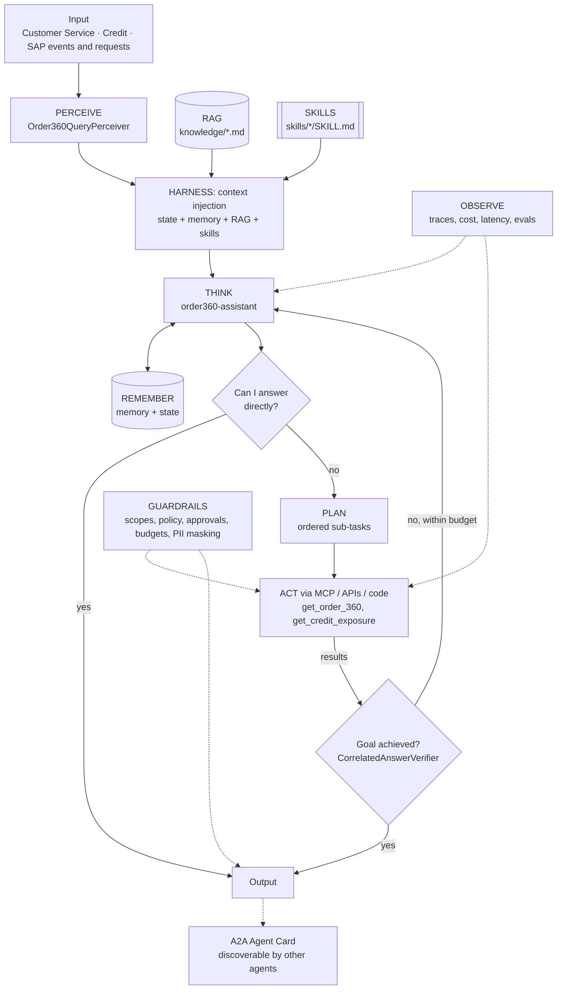

# Agent architecture: SAP Integration Suite: Order 360 Assistant (orders, deliveries, billing, credit)

## Agents
| Agent | Role | Perceiver | Goal check | Planner | Delegates to |
|-------|------|-----------|-----------|---------|--------------|
| `order360-assistant` | specialist | `Order360QueryPerceiver` | `CorrelatedAnswerVerifier` | no | - |

## Agentic AI concepts
| # | Concept | How this project uses it |
|---|---------|--------------------------|
| 1 | Memory & State | Memory: customer aliases. State: the customer's open orders and credit status during the conversation. |
| 2 | Orchestration | CPI multicast orchestrates S/4 + CRM calls; the agent sees one governed tool. |
| 3 | RAG | SAP status glossary retrieved so codes become plain English. |
| 4 | Harness | Correlation id flows from agent trace -> MCP -> API-M -> CPI and back into the answer. |
| 5 | Evals | Delivery, billing, credit-hold and glossary cases. |
| 6 | MCP | `get_order_360` is registered as an MCP tool in the Project 01 gateway. |
| 7 | Skills | `credit-hold-explainer`. |
| 8 | A2A | Publishes an Agent Card ('order-360') used by Project 08. |
| 9 | Multi-Agent System | Serves the Command Center as the SAP specialist. |
