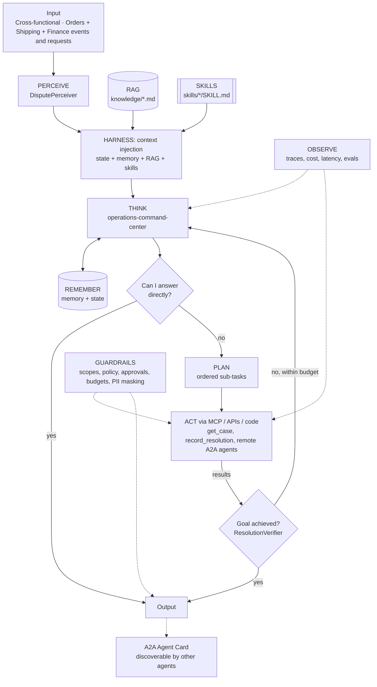

# Operations Command Center: Multi-Agent Dispute Resolution over A2A

> Part of the [Agentic Integration Portfolio](../../README.md): enterprise AI agents for a fictional company, Ridgeline Supply Co. All data is synthetic.

**Business operation:** Cross-functional · Orders + Shipping + Finance

A Command Center agent that discovers specialist agents (Orders, Shipping, Finance AR, SAP Order 360, Integration Ops) by their A2A Agent Cards and coordinates them to resolve cross-functional disputes with evidence.

## The business problem
Big Box Outdoor short-paid invoice INV-90412 by $4,860 with deduction code SHORT ("short shipment"). Today, resolving it takes AR, Logistics and Order Management three days of email. AR asks whether it was really short, Logistics pulls proof of delivery, Order Management checks the ASN, and someone checks whether an integration failure sent a wrong ASN. In this project a **Command Center** agent discovers the specialist agents from Projects 02–05 and 07 through their **A2A Agent Cards**, delegates to each over HTTP, and assembles a resolution package for a human to approve: accept the deduction and file a freight claim, or dispute it with evidence.

## Architecture


## Agentic AI concepts demonstrated
| # | Concept | How this project uses it |
|---|---------|--------------------------|
| 1 | Memory & State | State: the evolving case (who has answered, what's still open). Memory: past disputes and outcomes. |
| 2 | Orchestration | The Command Center is the manager; specialists are remote micro agents. |
| 3 | RAG | Dispute playbook retrieved and cited. |
| 4 | Harness | Case progress file persisted after every delegation; the case can be resumed. |
| 5 | Evals | End-to-end dispute scenarios scored on the recorded recommendation and specialists consulted. |
| 6 | MCP | Specialists use MCP tools through the Project 01 gateway; the Command Center uses A2A for agents. This is the MCP vs A2A distinction in one system. |
| 7 | Skills | `deduction-investigation`. |
| 8 | A2A | **Core of this project:** discovery via Agent Cards at `/.well-known/agent-card.json`, tasks and artifacts over JSON-RPC `message/send`, bearer-token auth. |
| 9 | Multi-Agent System | **Core of this project:** five specialists from four business functions collaborating through endpoints. |

## Run it
```bash
make test P=08          # from the repo root
make arch-check P=08
make eval P=08          # after Milestone 0
```

## Status
**Scaffold.** The agents assemble on agent-core with every layer and concept wired, and the architecture checks pass; the layer implementations are next. Eval results and a demo are added as milestones complete.

### Roadmap
| # | Milestone | Scope | Status |
|---|---|---|---|
| 0 | Architecture skeleton | Perceiver, state provider, tools on local mocks and goal verifiers, so every agent runs end to end on agent-core with a scripted LLM. | Planned |
| 1 | Local mesh with stub specialists | Serve two FakeLLM specialists over A2A; Command Center discovers cards and delegates. | Planned |
| 2 | serve_mesh.py | Launch real agents from Projects 02, 03, 04, 05, 07 as A2A servers; write a2a/registry.json. | Planned |
| 3 | Delegation + resolution packages | Command Center with dispute skill and playbook RAG; case store; record_resolution. | Planned |
| 4 | Stitched tracing | Collect specialist trace ids from task metadata into one case timeline view. | Planned |
| 5 | Evals | Cross-functional eval scenarios and baseline. | Planned |
| 6 | A2A spec conformance | Verify against the current A2A specification; optionally adopt the official SDK. | Planned |

### Evals
`evals/cases.json` holds 4 cases so far; `make eval P=08` runs them once the agents are implemented (Milestone 0), and the first run becomes the baseline that later runs must not fall below.

| Case | Input | Expected status | Must call | Must not call | Result |
|---|---|---|---|---|---|
| short-ship-deduction | Big Box Outdoor short-paid INV-90412 by $4,860, code SHORT. Resolve it. | answered | record_resolution | - | not run yet |
| price-deduction | Pinecrest Hardware deducted $312 on INV-90388, code PRICE. | answered | record_resolution | - | not run yet |
| asn-flow-failure | BBO fined us for an inaccurate ASN on PO-7722; was it our integration? | answered | - | - | not run yet |
| cs-question-routes-to-cs-copilot | Summit Contractors says SO-104233 hasn't arrived and they were billed. What should we t... | answered | ask_cs_copilot | record_resolution | not run yet |
