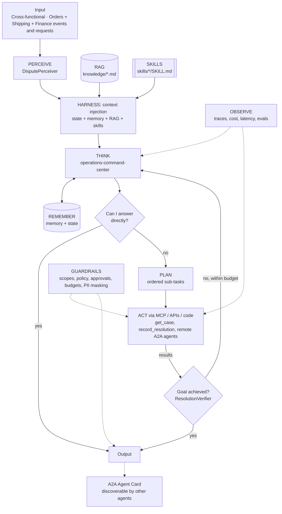

# Agent architecture: Operations Command Center: Multi-Agent Dispute Resolution over A2A

## Agents
| Agent | Role | Perceiver | Goal check | Planner | Delegates to |
|-------|------|-----------|-----------|---------|--------------|
| `operations-command-center` | specialist | `DisputePerceiver` | `ResolutionVerifier` | yes | - |

## Agentic AI concepts
| # | Concept | How this project uses it |
|---|---------|--------------------------|
| 1 | Memory & State | State: the evolving case (who has answered, what's still open). Memory: past disputes and outcomes. |
| 2 | Orchestration | The Command Center is the manager; specialists are remote micro agents. |
| 3 | RAG | Dispute playbook retrieved and cited. |
| 4 | Harness | Case progress file persisted after every delegation; the case can be resumed. |
| 5 | Evals | End-to-end dispute scenarios scored on the recorded recommendation and specialists consulted. |
| 6 | MCP | Specialists use MCP tools through the Project 01 gateway; the Command Center uses A2A for agents. This is the MCP vs A2A distinction in one system. |
| 7 | Skills | `deduction-investigation`. |
| 8 | A2A | **Core of this project:** discovery via Agent Cards at `/.well-known/agent-card.json`, tasks and artifacts over JSON-RPC `message/send`, bearer-token auth. |
| 9 | Multi-Agent System | **Core of this project:** five specialists from four business functions collaborating through endpoints. |
